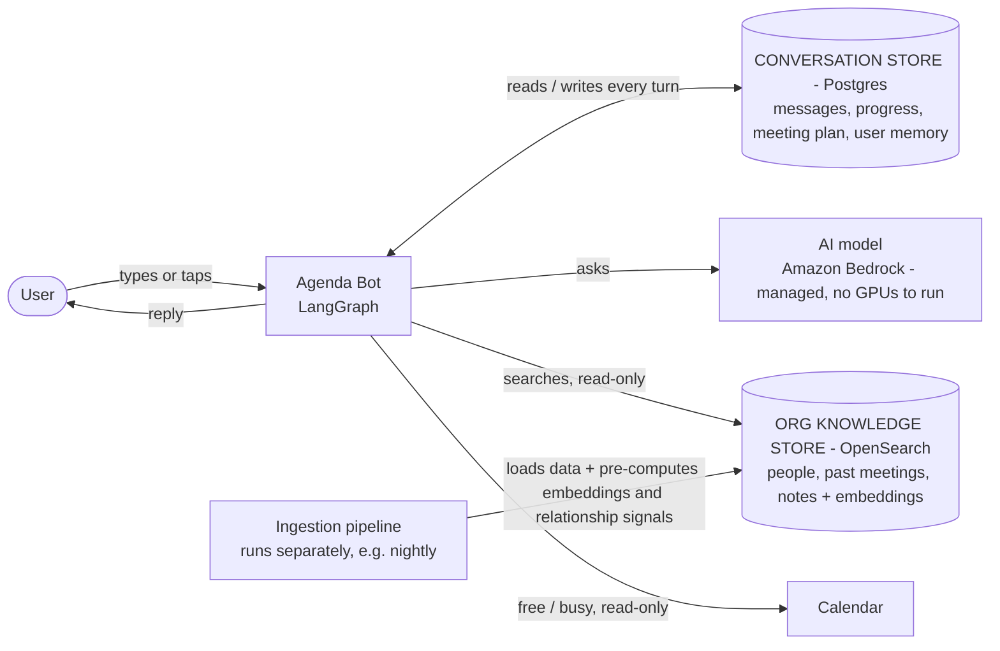
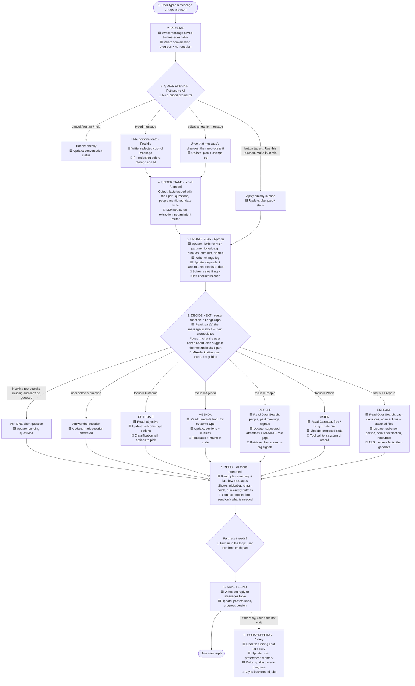
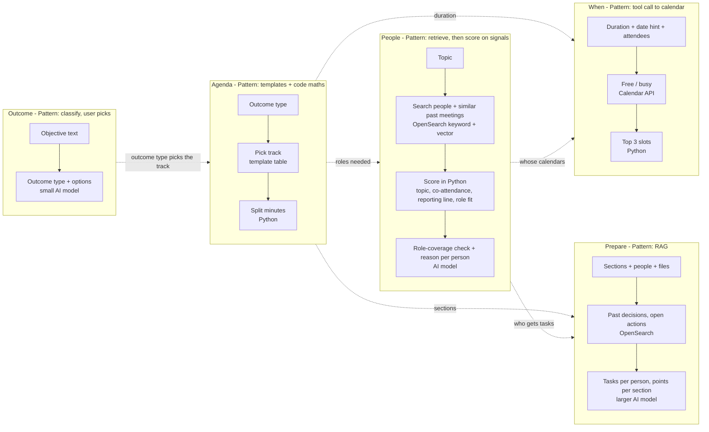
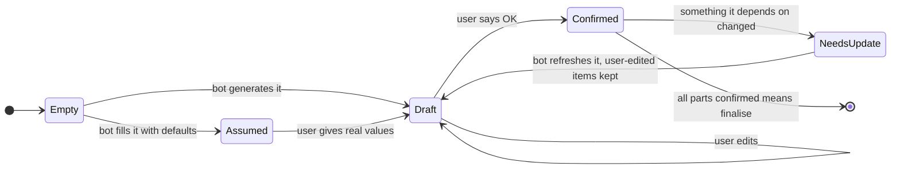
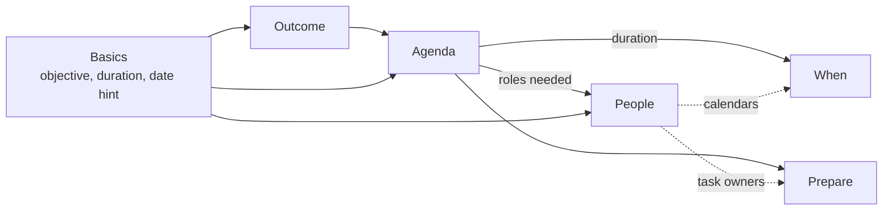
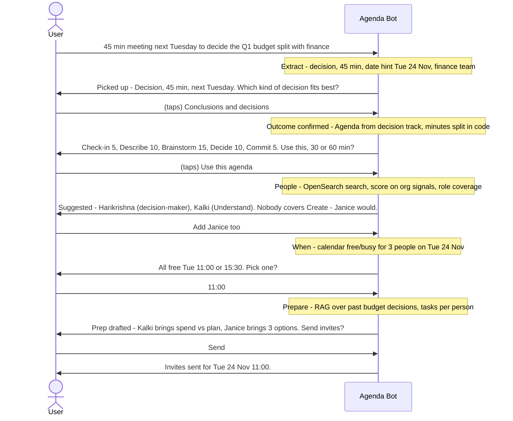
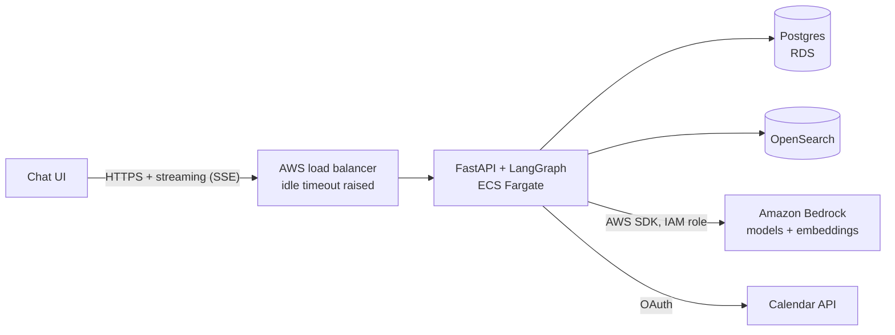

# Agenda Bot: High-Level Flow (for managers)

**What it does:** the user chats with the bot about a meeting they're planning. The bot asks only for what it's missing and builds **five parts** of the plan, matching the product's UI:

| # | Part | What the bot produces |
|---|---|---|
| 1 | **Outcome** | What the meeting must achieve, and its outcome type (e.g. a decision, getting aligned, planning, exploring ideas) |
| 2 | **Agenda** | The sections (track) and minutes for each, adding up to the meeting length |
| 3 | **People** | Suggested attendees with a reason each, plus a warning if a needed role is missing |
| 4 | **When** | Free time slots for the organiser and attendees, honouring any date the user mentioned |
| 5 | **Prepare** | A task for each person, agenda points and expected outcomes per section, and resources (pre-reads, files) |

> Diagrams use Mermaid (they render on GitHub). For Google Docs, paste each block into mermaid.live and insert the image.
> Each diagram box carries a one-line **Pattern** note: the industry approach used at that point. Section 7 has the full table with alternatives and reasons.

---

## 1. The big picture



**Stores and sources:**
- **Conversation store (Postgres):** what the bot itself writes. Messages, progress, the meeting plan and user memory.
- **Org knowledge store (OpenSearch):** company data the bot only *reads*. A separate pipeline loads people, past meetings and notes, and **creates their embeddings ahead of time**.
- **Calendar:** read live for free/busy when the When part runs. Invites are sent only after the user confirms.

---

## 2. What happens when a user sends a message

Legend: 🟦 **Reads** · 🟩 **Writes / updates** · 🧭 **Pattern** (the industry approach used)



### How "Decide next" (step 6) works: the user leads, the bot guides

**There's no fixed order the user must follow.** The stepper in the UI (Outcome · Agenda · People · When · Prepare) shows progress, but the user can start with any part: "who should be in the room?", "find me a slot Tuesday", "what should everyone prepare?". The bot only *suggests* the next unfinished part when the user hasn't said what they want.

**Two terms:**
- **Focus:** the part(s) *this message* is about. The extractor tags each fact and question with its part. If a message touches several parts, they're handled in the order of the table below.
- **Prerequisites:** the minimum a part needs before it can be produced. These are **dependencies, not a sequence**.

| Part | Minimum it needs | If that's missing |
|---|---|---|
| **Outcome** | What the meeting is about (objective) | **Ask** one question: "What should this meeting achieve?" |
| **Agenda** | Outcome type + duration | **Assume**: outcome type guessed from the objective, duration from user preference or 30 min. Mark as *assumed* and say so. |
| **People** | Objective (outcome type helps with role coverage) | Ask for the objective if missing; roles come from the agenda, or from the outcome type if there's no agenda yet |
| **When** | Duration (attendees help with free/busy) | Assume duration; check only the organiser's calendar until people are added; use any date hint ("next Tuesday") |
| **Prepare** | Agenda sections (people help with per-person tasks) | **Auto-draft** the agenda from the template (*assumed*); give tasks only to people already added |

**Who decides:** one small Python function, the router (a LangGraph *conditional edge*). It doesn't call the AI and doesn't run checks in parallel. For each message, in order:

```
1. Did the user ask a question?                → answer it (in the same reply as below)
2. Work out the FOCUS:
     the part(s) the message is about           → e.g. "When"
     if none (e.g. "hi", "ok")                  → the next unfinished part, as a suggestion
3. Check the focus part's PREREQUISITES:
     can't be guessed (no objective at all)     → ask ONE question
     can be guessed                             → fill with assumed defaults, say so
4. Produce that part                            → show it as a card, with quick-reply buttons
5. Suggest what else is unfinished              → "Want me to suggest who should be in the room?"
```

**Example: the user jumps straight to When**
> User: "Find a 45-min slot next Tuesday to decide the Q1 budget split."
> Bot: "Picked up: decision, 45 min, next Tuesday. You're free Tue 24 Nov at 11:00 or 15:30. I've assumed a standard decision agenda; want to see it, or add people first?"

**Does it ask about everything at once?** No. At most **one blocking question** per turn. Everything else is assumed and shown so the user can correct it. Information volunteered for any part (dates, names, timings) is **saved straight away** and used when that part runs, so a date mentioned in the first message isn't lost.

**Pattern:** *mixed-initiative dialogue* (either side can lead), with *prerequisite-driven slot filling* and *sensible defaults*. The AI writes the wording; code decides what is missing and what to assume.

### Where the embeddings happen

| Embedding | When it's created | Who creates it | Used for |
|---|---|---|---|
| **Org data** (people, past meetings, notes) | **Ahead of time**, by the ingestion pipeline | Pipeline → Bedrock embeddings → OpenSearch | People, Prepare |
| **The user's request** (e.g. "Q1 budget decision") | **Live, inside People / Prepare**, in milliseconds | Bedrock embedding model, called by the search tool | Matching against org embeddings |
| **The bot's own chat** (optional) | **After the reply**, in step 9 | Background worker | Only if we later want "search my old chats" |

### What is stored or updated, by step

| Step | Reads | Writes / updates | Store |
|---|---|---|---|
| 2 Receive | Conversation progress, plan | User message | Postgres |
| 3 Checks | — | Button result, status, or undo of an edited message | Postgres |
| 4 Understand | Message + last few turns | — (output passed on) | — |
| 5 Update plan | Current plan | Fields for any part, change log, needs-update flags | Postgres |
| 6 Decide | Part statuses, missing fields | — | — |
| Ask | — | Pending questions | Postgres |
| Outcome | Objective | Outcome type | Postgres |
| Agenda | Template track | Sections + minutes | Postgres |
| People | People, past meetings, signals | Suggested attendees, reasons, role gaps | Read OpenSearch → write Postgres |
| When | Calendar free/busy, date hint | Proposed slots, chosen slot | Read Calendar → write Postgres |
| Prepare | Past decisions, open actions, attached files | Tasks per person, points per section, resources | Read OpenSearch → write Postgres |
| 7 Reply | Plan summary, recent turns | — | — |
| 8 Save | — | Bot reply, part statuses, version | Postgres |
| 9 Housekeeping | Recent turns | Summary, preferences, traces | Postgres, Langfuse |

---

## 3. What each part calls (detail)



Parts can run in **any order**. Dotted arrows are dependencies, not a required sequence; a missing input is assumed, or asked once.

**Example replies:**
- Outcome: "You want to leave with a decision. Which kind fits best? Conclusions & decisions · Advice · Critical assessment"
- Agenda: "Check-in 5 · Describe situation 10 · Brainstorm 15 · Decide 10 · Commitments 5 = 45 min. Use this · 30 min · 60 min"
- People: "Harikrishna (decision-maker), Kalki (leads Understand)… Nobody covers Create yet: Janice would."
- When: "Free: Tue 24 Nov 11:00, Tue 15:30, Wed 10:00 · I'll pick later"
- Prepare: "Kalki: bring Q1 spend vs plan. Resources: budget sheet → all attendees."

---

## 4. Plan parts: what the bot tracks instead of forcing a sequence

The plan has **five parts** plus the basics (objective, duration, date hint). The bot keeps a **status for each part** and works on whichever part the user brings up. The UI stepper shows these statuses and is **clickable in any order**.



| Part status | Meaning | Stepper shows |
|---|---|---|
| Empty | Nothing yet | Number only |
| Assumed | Filled with defaults so another part could proceed | Dotted outline |
| Draft | Generated or edited, not yet approved | Half-filled |
| Confirmed | The user approved it | Green tick |
| Needs update | Something it depends on changed | Amber dot |

**Finalising:** Outcome, Agenda and People must be *Confirmed*. When can be "I'll pick later", and Prepare can be "Nothing to prepare". The bot then offers to send invites and **only sends after an explicit confirm**.

**How parts depend on each other:**



**Pattern:** *mixed-initiative* conversation over a **dependency graph** of parts, each with its own status, instead of a strict wizard.

### "Needs update" marking: built by us

No chatbot framework tracks dependencies between *generated results*, so this is our own small piece of code (the pattern is **dependency tracking with invalidation**, the way spreadsheets recalculate dependent cells):

```
Dependency map (config):
  objective       → Outcome, Agenda, People, Prepare
  outcome type    → Agenda, People (roles), Prepare
  duration        → Agenda, When, Prepare
  sections        → Prepare (changed sections only), People (role coverage)
  attendees       → When (free/busy), Prepare (tasks)
  chosen slot     → nothing

On every plan update (step 5):
  1. See which fields changed      2. Look up what depends on them
  3. Mark those parts "needs update" if they were Draft or Confirmed
  4. Next reply: "Duration changed, so the agenda no longer fits. Rebalance?"
  5. When refreshing, skip anything the user edited by hand
```

---

## 5. Decision rules: "if this, then that"

| If the user... | The bot... | Uses | Pattern |
|---|---|---|---|
| Taps a quick-reply button | Applies it in code, no AI | Python | Rule-based pre-router |
| Says cancel / start over / help | Handles it directly | Python rules | Rule-based pre-router |
| Describes the meeting | Shows "picked up" chips, saves facts for every part | Small AI + Postgres | Structured extraction + slot filling |
| Hasn't said what it should achieve | Asks one question | LangGraph | Slot filling |
| Asks about any part first | Assumes missing prerequisites, says so, produces it | Python + AI | Prerequisites with defaults |
| Wants attendees | Suggests people + role gaps | OpenSearch + Python scoring + AI | Retrieve, then score on signals |
| Wants a time | Proposes free slots, honouring date hints | Calendar tool + Python | Tool call |
| Wants prep | Drafts tasks per person + points per section | Larger AI + OpenSearch | RAG |
| Changes a time, section or person | Rechecks, marks dependent parts needs-update | Python | Dependency tracking |
| Edits an earlier message | Undoes its changes, re-processes it | Python + AI | Event log replay |
| Asks something ("should I add a demo?") | Answers it, then continues | AI model | Multi-question extraction |
| Says "send it" | Confirms the summary, then sends invites | Calendar tool | Human-in-the-loop before external actions |

---

## 6. Building blocks

| Block | Tool | Job in one line |
|---|---|---|
| Conversation flow | **LangGraph** | Tracks part statuses and decides what's next |
| AI model | **Amazon Bedrock** (e.g. Claude Opus 5.5; Claude Haiku 5.5 for extraction if needed) | Understands messages, writes replies and prep |
| Embeddings | **Bedrock embeddings** (Titan v2 or Cohere Embed) | Meaning-based search over org data |
| Conversation database | **PostgreSQL** | Stores messages, progress, plan, memory |
| Org knowledge search | **OpenSearch** (keyword + vector) | People, past meetings, notes; relationship signals pre-computed |
| Calendar | Calendar API (Google / Microsoft) | Free/busy, sending invites after confirm |
| Data checks | **Pydantic** + Python | Makes sure AI output is valid |
| Privacy | **Presidio** | Hides personal data |
| Background jobs | **Celery** | Summaries and preferences without slowing the chat |
| Quality | **Langfuse** + **promptfoo** / **DeepEval** | Records every turn; tests that changes don't break things |

---

## 7. Design choices: which industry pattern we use, and why

| # | Decision point | ✅ What we use (industry pattern) | ❌ Instead of | Why we chose it | Who else does this |
|---|---|---|---|---|---|
| P1 | Buttons and fixed commands | **Rule-based pre-router**: buttons and "cancel / help" handled in code | Sending every input to an LLM | Instant, free, predictable | Anthropic's routing pattern allows non-LLM classifiers |
| P2 | Understanding the message | **LLM structured extraction**: one call returns all facts (tagged by part) and questions | **Embedding router** or **LLM intent classifier** | Users give details for several parts in one message; an embedding router picks only one intent | Rasa CALM command generator, OpenAI Structured Outputs |
| P3 | Collecting details | **Schema-driven slot filling** | Fixed question-by-question script | Never asks for something already given | Dialogflow CX forms, Rasa flows |
| P4 | Controlling the flow | **Mixed-initiative over a dependency graph** of 5 parts | A **strict wizard** or a **fully autonomous agent** | Users don't think in stages; code-driven checks stay testable | Mixed-initiative dialogue research; Dialogflow CX route groups |
| P5 | Writing prep | **RAG**: retrieve, then generate | AI writing from general knowledge | Grounded in real company history | Standard RAG; LinkedIn, Airbnb assistants |
| P6 | Memory in this conversation | **Structured state + last N turns + running summary** | Sending the whole chat every time | Cheaper, faster, more accurate | Anthropic context engineering, "Lost in the Middle" |
| P7 | Memory across conversations | **Semantic** (preferences) + **episodic** (past agendas) memory | No memory, or dumping old chats | Personal defaults without bloating prompts | ChatGPT memory, Mem0, MemGPT |
| P8 | Moving between parts | **Human-in-the-loop confirmation**, always before sending invites | Auto-generating and auto-sending | The user stays in control | LangGraph interrupts |
| P9 | Timings and validation | **Deterministic code**; the AI only proposes | Trusting the AI with maths | Exact and reliable | Anthropic: put checks in tools |
| P10 | Suggesting attendees | **Two-stage recommender** on org signals + AI reasons | Asking the AI directly; a text reranker; a graph DB | Ranking people is about relationships and roles | LinkedIn People You May Know |
| P11 | Privacy | **PII redaction** before storage and AI | Raw text everywhere | Compliance | Microsoft Presidio |
| P12 | Quality | **Tracing + evals with simulated users** | Manual spot checks | Catches regressions | Langfuse, promptfoo / DeepEval |
| P13 | Where data lives | **Separate stores**: Postgres (bot) and OpenSearch (org knowledge) | One store for everything | Each store is used for what it's best at | Common RAG architecture |
| P14 | Background work | **Async jobs** after the reply | Doing everything before replying | Faster replies | Standard practice |
| P15 | Model hosting | **Managed models on Amazon Bedrock** | Self-hosted Qwen3 on vLLM (GPU servers) | No GPU ops; strong tool use; data stays in our AWS account. Trade-off: the model isn't open source | Common for enterprise AWS teams |
| P16 | Editing a past message | **Event log replay**: undo that message's recorded changes, re-extract | Ignoring edits, or rebuilding the whole plan | Precise, and keeps user-edited items | Event sourcing |
| P17 | Time slots | **Tool call to the calendar (system of record)** | AI guessing times | Always correct availability | Standard agent tool use |

### Where we might switch patterns later

| If this happens… | Switch to |
|---|---|
| The bot grows to handle many unrelated tasks | Add an **embedding router** in front, with an **LLM router fallback** |
| Conversations get very long | Add **search over chat history** |
| One part becomes heavy (e.g. analysing 20 past meetings) | Make it a **sub-agent used as a tool** |

---

## 8. A sample conversation



---

## 9. Relationship data and deployment

**Who is connected to whom** (reporting line, frequent collaborators, topic owners, typical meeting roles) is **pre-computed by the ingestion pipeline** into each person's OpenSearch record:
```jsonc
{"person_id": "p_42", "manager_id": "p_7", "reports": ["p_51"],
 "top_collaborators": [{"id": "p_51", "co_meetings_90d": 12}],
 "topics_owned": ["Q1 budget"], "meeting_roles": {"decide": 0.8, "understand": 0.3, "create": 0.1}}
```
No graph database for now. Add one (Apache AGE in Postgres, or Neo4j) only for multi-hop questions.

**Running it:**



---

*Sources for every pattern are in `citations.md`. Delivery plan by phase: `roadmap.md`. Technical detail: `implementation.md`.*
