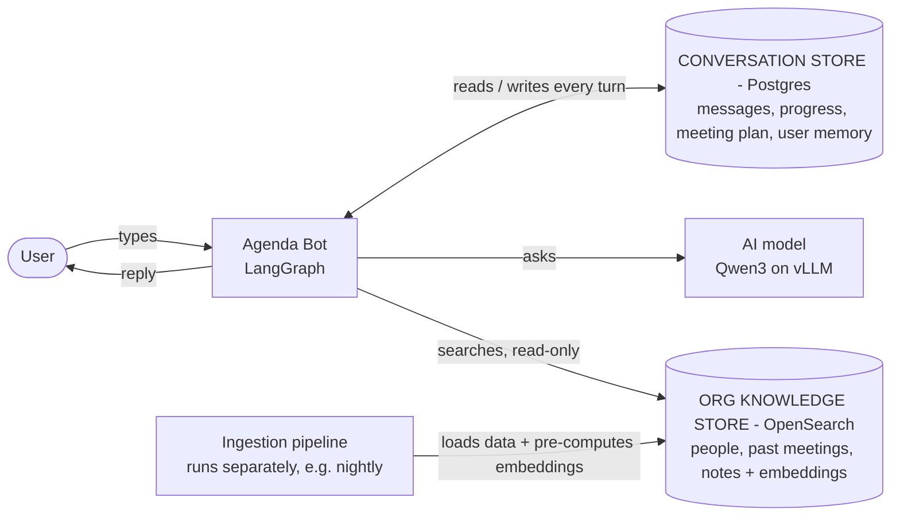
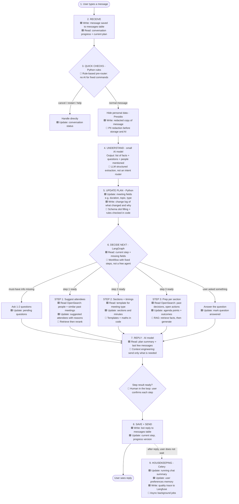
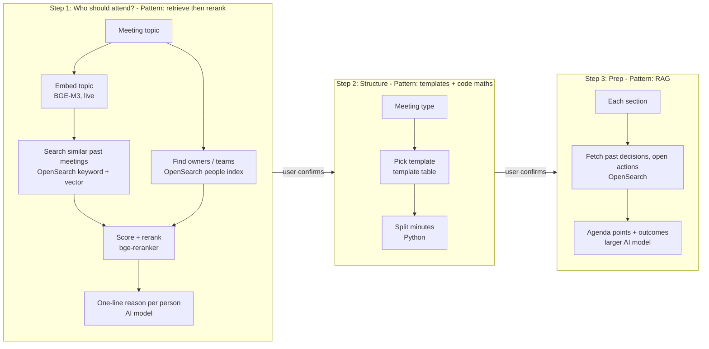
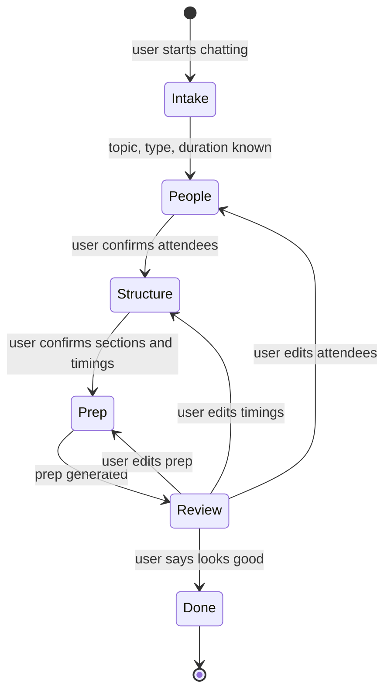
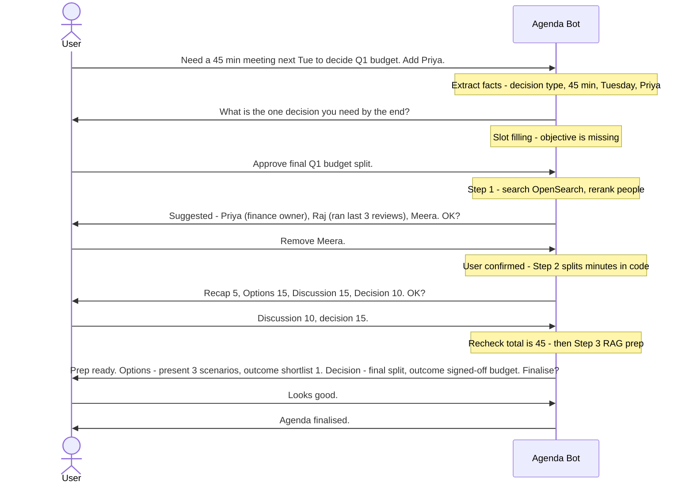

# Agenda Bot: High-Level Flow (for managers)

**What it does:** the user chats with the bot about a meeting they're planning. The bot asks for what it needs and builds three things:
1. **Who should attend** (suggested people)
2. **Meeting structure** (sections and minutes for each)
3. **What to prepare** (agenda points and expected outcomes for each section)

> Diagrams use Mermaid (they render on GitHub). For Google Docs, paste each block into mermaid.live and insert the image.
> Each diagram box carries a one-line **Pattern** note: the industry approach used at that point. Section 7 has the full table with alternatives and reasons.

---

## 1. The big picture

**Two stores, two jobs:**
- **Conversation store (Postgres):** what the bot itself writes. Messages, progress, the meeting plan and user memory.
- **Org knowledge store (OpenSearch):** company data the bot only *reads*. A separate pipeline loads people, past meetings and notes, and **creates their embeddings ahead of time**, so the bot never waits for that.

---

## 2. What happens when a user sends a message

Legend: 🟦 **Reads** · 🟩 **Writes / updates** · 🧭 **Pattern** (the industry approach used)

### Where the embeddings happen (clarifying step 9)

| Embedding | When it's created | Who creates it | Used for |
|---|---|---|---|
| **Org data** (people, past meetings, notes) | **Ahead of time**, by the ingestion pipeline | Pipeline → OpenSearch | Steps 1 and 3 |
| **The user's request** (e.g. "Q1 budget decision") | **Live, inside Step 1 / Step 3**, a few milliseconds | Embedding model (BGE-M3), called by the search tool | Matching against the org embeddings |
| **The bot's own chat** (optional) | **After the reply**, in step 9 | Background worker | Only if we later want "search my old chats" |

So the decisions in Steps 1 and 3 **do** use embeddings and org knowledge, live. Step 9 only does housekeeping that the *next* turns benefit from (summary, preferences, traces). Nothing in step 9 is needed to answer the current message.

### What is stored or updated, by step

| Step | Reads | Writes / updates | Store |
|---|---|---|---|
| 2 Receive | Conversation progress, plan | User message | Postgres |
| 3 Checks | — | Redacted message copy; status if cancel/restart | Postgres |
| 4 Understand | Message + last few turns | — (output passed on) | — |
| 5 Update plan | Current plan | Meeting fields, change log | Postgres |
| 6 Decide | Step, missing fields | — | — |
| Ask | — | Pending questions | Postgres |
| Step 1 | People, past meetings | Suggested attendees + reasons | Read OpenSearch → write Postgres |
| Step 2 | Template | Sections + minutes | Postgres |
| Step 3 | Past decisions, actions | Agenda points + outcomes per section | Read OpenSearch → write Postgres |
| 7 Reply | Plan summary, recent turns | — | — |
| 8 Save | — | Bot reply, current step, version | Postgres |
| 9 Housekeeping | Recent turns | Summary, preferences, traces | Postgres, Langfuse |

---

## 3. What each step calls (detail)

**Example replies:**
- Step 1: "I suggest Priya (owns Q1 budget), Raj (attended last 3 reviews)… OK?"
- Step 2: "Recap 5 · Options 15 · Discussion 15 · Decision 10 = 45 min. Changes?"
- Step 3: "Options: present 3 budget scenarios → outcome: shortlist 1…"

---

## 4. Conversation stages: where the user is in the journey

**What this section means:** a conversation isn't one question and one answer. It moves through **stages**, like a form wizard but in chat. The bot always knows which stage the user is in (saved as `current step` in Postgres), and that decides what it asks or does next (step 6 in section 2). Users can also jump back to an earlier stage at any time.

| Stage | Bot's goal | Moves on when |
|---|---|---|
| Intake | Collect the basics: topic, objective, meeting type, duration, date | All must-have fields are filled |
| People | Suggest attendees (Step 1) | User confirms the list |
| Structure | Propose sections and timings (Step 2) | User confirms, and the minutes add up |
| Prep | Write agenda points and outcomes per section (Step 3) | Prep is generated |
| Review | Show the full agenda | User says "looks good", or edits something |
| Done | Agenda finalised | — |

**Pattern:** a *workflow state machine with human confirmation gates*, the same idea as Dialogflow CX pages/forms and Rasa flows. If an earlier stage changes (say the duration), later stages are marked "needs update" and the bot offers to refresh them. Edits the user made by hand are never overwritten.

---

## 5. Decision rules: "if this, then that"

| If the user's message... | The bot... | Uses | Pattern |
|---|---|---|---|
| Says cancel / start over / help | Handles it directly | Python rules | Rule-based pre-router |
| Gives meeting details | Saves them, asks for anything missing | Small AI + Postgres | Structured extraction + slot filling |
| Is missing must-have info | Asks 1–2 short questions | LangGraph | Slot filling |
| Has enough info for people | Suggests attendees | OpenSearch + reranker + AI | Retrieve then rerank |
| Confirms the people | Proposes sections and timings | Templates + Python | Human-in-the-loop, code for maths |
| Changes a time or section | Rechecks timings, shows update | Python | Validation in code |
| Confirms the structure | Writes prep per section | Larger AI + OpenSearch | RAG |
| Asks something ("should I add a demo?") | Answers it, then continues | AI model | Multi-question extraction |
| Refers to something said earlier | Finds it in saved progress, or searches the chat | Postgres | Structured state + summary |
| Says "looks good" at the end | Finalises the agenda | Postgres | Human-in-the-loop |

---

## 6. Building blocks (all open source)

| Block | Tool | Job in one line |
|---|---|---|
| Conversation flow | **LangGraph** | Tracks the stage and decides what's next |
| AI model | **Qwen3** on **vLLM** | Understands messages, writes replies and prep |
| Conversation database | **PostgreSQL** | Stores messages, progress, plan, memory |
| Org knowledge search | **OpenSearch** (keyword + vector) + **BGE-M3** + **bge-reranker** | Finds related people, meetings and notes |
| Data checks | **Pydantic** + Python | Makes sure AI output is valid |
| Privacy | **Presidio** | Hides personal data |
| Background jobs | **Celery** | Summaries and preferences without slowing the chat |
| Quality | **Langfuse** + **promptfoo** / **DeepEval** | Records every turn; tests that changes don't break things |

**What an embedding is:** a numeric fingerprint of text's meaning. It lets the bot find "similar" meetings even when the words differ.

---

## 7. Design choices: which industry pattern we use, and why

| # | Decision point | ✅ What we use (industry pattern) | ❌ Instead of | Why we chose it | Who else does this |
|---|---|---|---|---|---|
| P1 | Handling "cancel / help / restart" | **Rule-based pre-router** | Sending every message to an LLM | Instant, free and predictable for fixed commands | Anthropic's "routing" pattern allows non-LLM classifiers |
| P2 | Understanding the message | **LLM structured extraction**: one call returns all facts and questions as a list | **Embedding router** (picks one nearest intent) or an **LLM intent classifier** | Our bot fills a form, it isn't choosing between 20 intents. Users give several details and questions in one message, which an embedding router can't split. | Rasa CALM command generator, OpenAI Structured Outputs |
| P3 | Collecting details | **Schema-driven slot filling** | Fixed question-by-question script | Never asks for something already given; "done" is checkable | Dialogflow CX forms, Rasa flows |
| P4 | Controlling the flow | **Workflow with gates** (state machine) | **Fully autonomous agent** | Predictable, testable, auditable; the steps are known in advance | Anthropic "Building effective agents" |
| P5 | Writing prep | **RAG**: retrieve, then generate | AI writing from general knowledge | Grounded in real company history | Standard RAG; LinkedIn and Airbnb assistants |
| P6 | Memory in this conversation | **Structured state + last N turns + running summary** | Sending the whole chat every time | Cheaper, faster, more accurate | Anthropic context engineering, "Lost in the Middle" |
| P7 | Memory across conversations | **Semantic memory** (preferences) + **episodic memory** (past agendas) | No memory, or dumping all old chats | Personal defaults without bloating prompts | ChatGPT memory, Mem0, MemGPT |
| P8 | Moving between stages | **Human-in-the-loop confirmation** | Auto-generating everything | The user stays in control; errors are caught early | LangGraph interrupts |
| P9 | Timings and validation | **Deterministic code**; the AI only proposes | Trusting the AI with maths | Exact and reliable | Anthropic: put checks in tools |
| P10 | Suggesting attendees | **Retrieve, then rerank** + AI explanation | Asking the AI directly | Real data, scalable, explainable | Two-stage recommender design |
| P11 | Privacy | **PII redaction** before storage and AI | Raw text everywhere | Compliance | Microsoft Presidio |
| P12 | Quality | **Tracing + evals with simulated users** | Manual spot checks | Catches regressions | Langfuse, promptfoo / DeepEval |
| P13 | Where data lives | **Separate stores**: Postgres for the bot's data, OpenSearch for org knowledge | One store for everything | Each store is used for what it's best at; org data has its own pipeline and permissions | Common RAG architecture |
| P14 | Background work | **Async jobs** after the reply | Doing everything before replying | Faster replies | Standard practice for chat systems |

### Where we might switch patterns later

| If this happens… | Switch to |
|---|---|
| The bot grows to handle many unrelated tasks | Add an **embedding router** in front, with an **LLM router fallback** |
| Conversations get very long | Add **search over chat history** (pgvector or an OpenSearch index on messages) |
| One step becomes heavy (e.g. analysing 20 past meetings) | Make it a **sub-agent used as a tool** |

---

## 8. A sample conversation

---

*Sources for every pattern are in `citations.md` (Anthropic, Rasa, Dialogflow CX, OpenAI, LinkedIn, Airbnb, Lost in the Middle, MemGPT, Mem0, ChatGPT memory, OpenSearch, Langfuse).*
