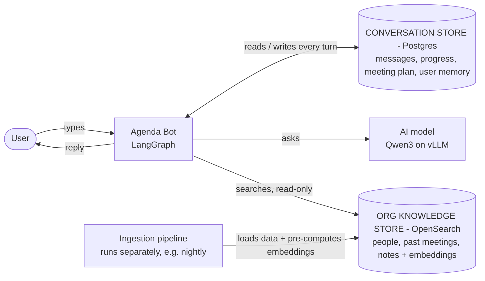
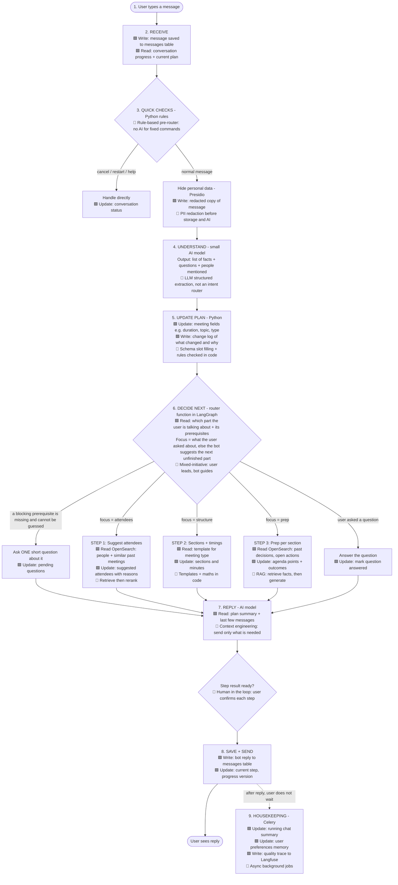
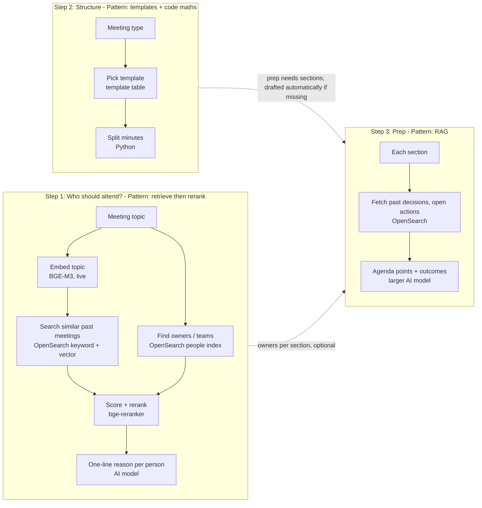
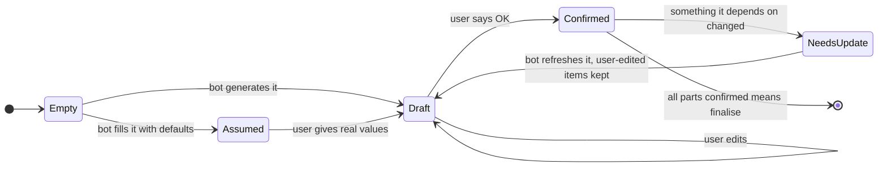
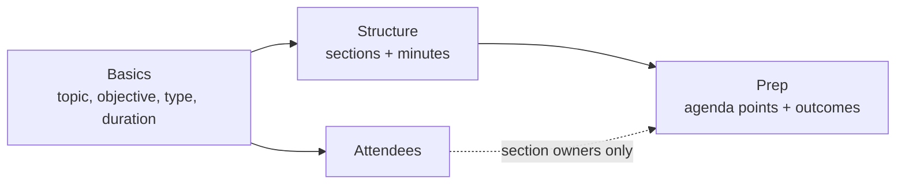
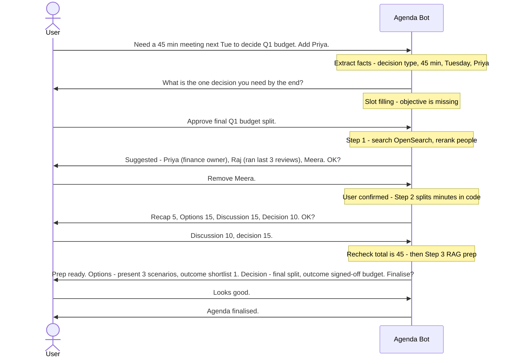

# Agenda Bot: High-Level Flow

**What it does:** the user chats with the bot about a meeting they're planning. The bot asks for what it needs and builds three things:
1. **Who should attend** (suggested people)
2. **Meeting structure** (sections and minutes for each)
3. **What to prepare** (agenda points and expected outcomes for each section)

> Each diagram box carries a one-line **Pattern** note: the industry approach used at that point. Section 7 has the full table with alternatives and reasons.

---

## 1. The big picture



**Two stores, two jobs:**
- **Conversation store (Postgres):** what the bot itself writes. Messages, progress, the meeting plan and user memory.
- **Org knowledge store (OpenSearch):** company data the bot only *reads*. A separate pipeline loads people, past meetings and notes, and **creates their embeddings ahead of time**, so the bot never waits for that.

---

## 2. What happens when a user sends a message

Legend: 🟦 **Reads** · 🟩 **Writes / updates** · 🧭 **Pattern** (the industry approach used)



### How "Decide next" (step 6) works: the user leads, the bot guides

**There's no fixed order the user must follow.** The user can start anywhere: "who should attend?", "give me an agenda", "what should I prepare for the budget section?". The bot handles whichever part the user is talking about. It only *suggests* the next unfinished part when the user hasn't said what they want.

**Two terms:**
- **Focus:** the part of the plan *this message* is about (attendees, structure or prep). The extractor in step 4 tags each fact and question with the part it belongs to. If the message touches several parts, they're handled in the order of the prerequisites table below.
- **Prerequisites:** the minimum a part needs before it can be produced. These are **dependencies, not a sequence**.

| Part | Minimum it needs | If that's missing |
|---|---|---|
| **Attendees** | Topic or objective | Ask one question: "What's the meeting about?" |
| **Structure** (sections + minutes) | Meeting type + duration | **Assume** them (type guessed from the topic, 30 min default), mark as *assumed*, tell the user |
| **Prep** (agenda points + outcomes) | Objective + sections | **Auto-draft** sections from the template, mark as *assumed*, carry on |

**Who decides:** one small Python function, the router (a LangGraph *conditional edge*). It doesn't call the AI, and it doesn't run checks in parallel. For each message it goes through these in order:

```
1. Did the user ask a question?                → answer it (in the same reply as below)
2. Work out the FOCUS:
     the part(s) the message is about           → e.g. "prep"
     if none (e.g. "hi", "ok")                  → the next unfinished part, as a suggestion
3. Check the focus part's PREREQUISITES:
     can't be guessed (no topic at all)         → ask ONE question
     can be guessed                             → fill with assumed defaults, say so
4. Produce that part                            → show it, ask "OK or change?"
5. Suggest what else is unfinished              → "Want me to suggest attendees too?"
```

**Example: the user jumps straight to prep**
> User: "What should I prepare for my Q1 budget decision meeting?"
> Bot: "Assuming 45 minutes with Recap, Options, Discussion and Decision. Here's the prep for each section… Want me to suggest attendees as well?"

The bot didn't force the user through attendees first. It assumed the structure, said so, and offered the rest.

**Does it ask about everything at once?** No. At most **one blocking question** per turn, and only when a guess isn't possible. Everything else is assumed and shown, so the user can correct it. Information the user volunteers for any part is always saved straight away.

**Pattern:** *mixed-initiative dialogue*, a long-standing idea in dialogue research where either the user or the system can take the lead. It's combined with *slot filling driven by prerequisites* and *sensible defaults*. The AI writes the wording; code decides what is missing and what to assume.

### Where the embeddings happen (clarifying step 9)

| Embedding | When it's created | Who creates it | Used for |
|---|---|---|---|
| **Org data** (people, past meetings, notes) | **Ahead of time**, by the ingestion pipeline | Pipeline → OpenSearch | Steps 1 and 3 |
| **The user's request** (e.g. "Q1 budget decision") | **Live, inside Step 1 / Step 3**, a few milliseconds | Embedding model (BGE-M3), called by the search tool | Matching against the org embeddings |
| **The bot's own chat** (optional) | **After the reply**, in step 9 | Background worker | Only if we later want "search my old chats" |

So the decisions in Steps 1 and 3 **do** use embeddings and org knowledge, live. Step 9 only does housekeeping that the *next* turns benefit from (summary, preferences, traces). Nothing in step 9 is needed to answer the current message.

### What is stored or updated, by step

| Step | Reads | Writes / updates | Store |
|---|---|---|---|
| 2 Receive | Conversation progress, plan | User message | Postgres |
| 3 Checks | — | Redacted message copy; status if cancel/restart | Postgres |
| 4 Understand | Message + last few turns | — (output passed on) | — |
| 5 Update plan | Current plan | Meeting fields, change log | Postgres |
| 6 Decide | Step, missing fields | — | — |
| Ask | — | Pending questions | Postgres |
| Step 1 | People, past meetings | Suggested attendees + reasons | Read OpenSearch → write Postgres |
| Step 2 | Template | Sections + minutes | Postgres |
| Step 3 | Past decisions, actions | Agenda points + outcomes per section | Read OpenSearch → write Postgres |
| 7 Reply | Plan summary, recent turns | — | — |
| 8 Save | — | Bot reply, current step, version | Postgres |
| 9 Housekeeping | Recent turns | Summary, preferences, traces | Postgres, Langfuse |

---

## 3. What each step calls (detail)



These three can run in **any order**, whichever the user asks for. Dotted arrows are dependencies, not a required sequence.

**Example replies:**
- Step 1: "I suggest Priya (owns Q1 budget), Raj (attended last 3 reviews)… OK?"
- Step 2: "Recap 5 · Options 15 · Discussion 15 · Decision 10 = 45 min. Changes?"
- Step 3: "Options: present 3 budget scenarios → outcome: shortlist 1…"

---

## 4. Plan parts: what the bot tracks instead of forcing a sequence

**What this section means:** the plan has **three parts** (attendees, structure, prep) plus the basics (topic, objective, type, duration). The bot doesn't walk the user through them in a fixed order. It keeps a **status for each part** and works on whichever part the user brings up (section 2, step 6).



| Part status | Meaning |
|---|---|
| Empty | Nothing yet |
| Assumed | Filled with defaults so another part could proceed; the user was told |
| Draft | Generated or edited, not yet approved |
| Confirmed | The user approved it |
| Needs update | Something it depends on changed after it was confirmed |

**Finalising:** when all three parts are *Confirmed*, the bot offers to finalise. The user can ask to finalise earlier, and the bot then lists anything still *Assumed* or *Draft*.

**How parts depend on each other:**



**Pattern:** a *mixed-initiative* conversation over a **dependency graph** of plan parts, each with its own status, instead of a strict step-by-step wizard. Dialogflow CX and Rasa offer something similar, letting a user jump to another page or flow from anywhere, but the part statuses and dependencies are our own logic. If something a part depends on changes (say the duration), that part is marked "needs update" and the bot offers to refresh it. Edits the user made by hand are never overwritten.

### "Needs update" marking: framework feature or built by us?

**Built by us.** It's a small piece of our own code. No chatbot framework (LangGraph, Rasa, Dialogflow CX) does it for you:
- LangGraph stores and restores state and lets you go back to an earlier step, but it doesn't know that "attendees depend on the objective".
- Rasa and Dialogflow CX can reset slots when you re-enter a flow, but they don't track dependencies between *generated results*.

The idea itself is a well-known engineering pattern: **dependency tracking with invalidation**. It's how spreadsheets recalculate dependent cells and how build tools rebuild only what changed. We apply it to the plan.

**How we build it (simple):**

```
Dependency map (config):
  objective, topic, meeting_type  → affect: Step 1 (people), Step 2 (structure), Step 3 (prep)
  duration                        → affects: Step 2 (structure), Step 3 (prep)
  attendees                       → affects: Step 3 (prep: owners per section)
  sections / minutes              → affects: Step 3 (prep for changed sections only)

On every plan update (step 5 in section 2):
  1. See which fields changed
  2. Look up what depends on them
  3. Mark those stages "needs update" (stage_status = stale)
  4. Next reply: "The duration changed, so the timings no longer fit. Shall I rebalance?"
  5. When refreshing, skip anything marked user_edited
```

About 50–100 lines in the Plan Service: a dependency map, a `stage_status` field per stage and a `source` field (generated / user_edited) per item. These fields are already in the data model in `implementation.md` (section 6).

---

## 5. Decision rules: "if this, then that"

| If the user's message... | The bot... | Uses | Pattern |
|---|---|---|---|
| Says cancel / start over / help | Handles it directly | Python rules | Rule-based pre-router |
| Gives meeting details | Saves them, asks for anything missing | Small AI + Postgres | Structured extraction + slot filling |
| Is missing must-have info | Asks 1–2 short questions | LangGraph | Slot filling |
| Has enough info for people | Suggests attendees | OpenSearch + reranker + AI | Retrieve then rerank |
| Confirms one part | Marks it confirmed, suggests an unfinished part | LangGraph | Human-in-the-loop, mixed initiative |
| Asks for a later part first (e.g. prep) | Assumes the missing prerequisites, says so, produces it | Templates + Python + AI | Prerequisites with defaults |
| Changes a time or section | Rechecks timings, shows update | Python | Validation in code |
| Confirms the structure | Writes prep per section | Larger AI + OpenSearch | RAG |
| Asks something ("should I add a demo?") | Answers it, then continues | AI model | Multi-question extraction |
| Refers to something said earlier | Finds it in saved progress, or searches the chat | Postgres | Structured state + summary |
| Says "looks good" at the end | Finalises the agenda | Postgres | Human-in-the-loop |

---

## 6. Building blocks (all open source)

| Block | Tool | Job in one line |
|---|---|---|
| Conversation flow | **LangGraph** | Tracks the stage and decides what's next |
| AI model | **Qwen3** on **vLLM** | Understands messages, writes replies and prep |
| Conversation database | **PostgreSQL** | Stores messages, progress, plan, memory |
| Org knowledge search | **OpenSearch** (keyword + vector) + **BGE-M3** + **bge-reranker** | Finds related people, meetings and notes |
| Data checks | **Pydantic** + Python | Makes sure AI output is valid |
| Privacy | **Presidio** | Hides personal data |
| Background jobs | **Celery** | Summaries and preferences without slowing the chat |
| Quality | **Langfuse** + **promptfoo** / **DeepEval** | Records every turn; tests that changes don't break things |

**What an embedding is:** a numeric fingerprint of text's meaning. It lets the bot find "similar" meetings even when the words differ.

---

## 7. Design choices: which industry pattern we use, and why

| # | Decision point | ✅ What we use (industry pattern) | ❌ Instead of | Why we chose it | Who else does this |
|---|---|---|---|---|---|
| P1 | Handling "cancel / help / restart" | **Rule-based pre-router** | Sending every message to an LLM | Instant, free and predictable for fixed commands | Anthropic's "routing" pattern allows non-LLM classifiers |
| P2 | Understanding the message | **LLM structured extraction**: one call returns all facts and questions as a list | **Embedding router** (picks one nearest intent) or an **LLM intent classifier** | Our bot fills a form, it isn't choosing between 20 intents. Users give several details and questions in one message, which an embedding router can't split. | Rasa CALM command generator, OpenAI Structured Outputs |
| P3 | Collecting details | **Schema-driven slot filling** | Fixed question-by-question script | Never asks for something already given; "done" is checkable | Dialogflow CX forms, Rasa flows |
| P4 | Controlling the flow | **Mixed-initiative over a dependency graph**: the user picks the part, code checks prerequisites, missing ones are assumed or asked once | A **strict wizard** (fixed order) or a **fully autonomous agent** | Users don't think in stages. Code-driven checks stay predictable and testable. | Mixed-initiative dialogue research; Dialogflow CX route groups; Anthropic "Building effective agents" (keep control in code) |
| P5 | Writing prep | **RAG**: retrieve, then generate | AI writing from general knowledge | Grounded in real company history | Standard RAG; LinkedIn and Airbnb assistants |
| P6 | Memory in this conversation | **Structured state + last N turns + running summary** | Sending the whole chat every time | Cheaper, faster, more accurate | Anthropic context engineering, "Lost in the Middle" |
| P7 | Memory across conversations | **Semantic memory** (preferences) + **episodic memory** (past agendas) | No memory, or dumping all old chats | Personal defaults without bloating prompts | ChatGPT memory, Mem0, MemGPT |
| P8 | Moving between stages | **Human-in-the-loop confirmation** | Auto-generating everything | The user stays in control; errors are caught early | LangGraph interrupts |
| P9 | Timings and validation | **Deterministic code**; the AI only proposes | Trusting the AI with maths | Exact and reliable | Anthropic: put checks in tools |
| P10 | Suggesting attendees | **Retrieve, then rerank** + AI explanation | Asking the AI directly | Real data, scalable, explainable | Two-stage recommender design |
| P11 | Privacy | **PII redaction** before storage and AI | Raw text everywhere | Compliance | Microsoft Presidio |
| P12 | Quality | **Tracing + evals with simulated users** | Manual spot checks | Catches regressions | Langfuse, promptfoo / DeepEval |
| P13 | Where data lives | **Separate stores**: Postgres for the bot's data, OpenSearch for org knowledge | One store for everything | Each store is used for what it's best at; org data has its own pipeline and permissions | Common RAG architecture |
| P14 | Background work | **Async jobs** after the reply | Doing everything before replying | Faster replies | Standard practice for chat systems |

### Where we might switch patterns later

| If this happens… | Switch to |
|---|---|
| The bot grows to handle many unrelated tasks | Add an **embedding router** in front, with an **LLM router fallback** |
| Conversations get very long | Add **search over chat history** (pgvector or an OpenSearch index on messages) |
| One step becomes heavy (e.g. analysing 20 past meetings) | Make it a **sub-agent used as a tool** |

---

## 8. A sample conversation



---

*Sources for every pattern are in `citations.md` (Anthropic, Rasa, Dialogflow CX, OpenAI, LinkedIn, Airbnb, Lost in the Middle, MemGPT, Mem0, ChatGPT memory, OpenSearch, Langfuse).*
