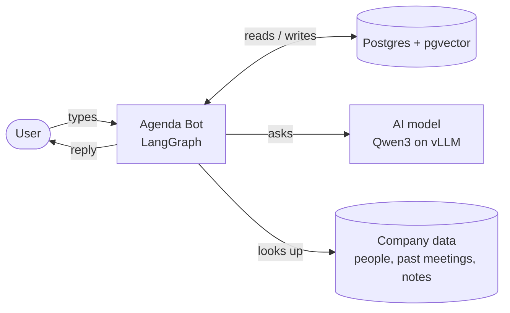
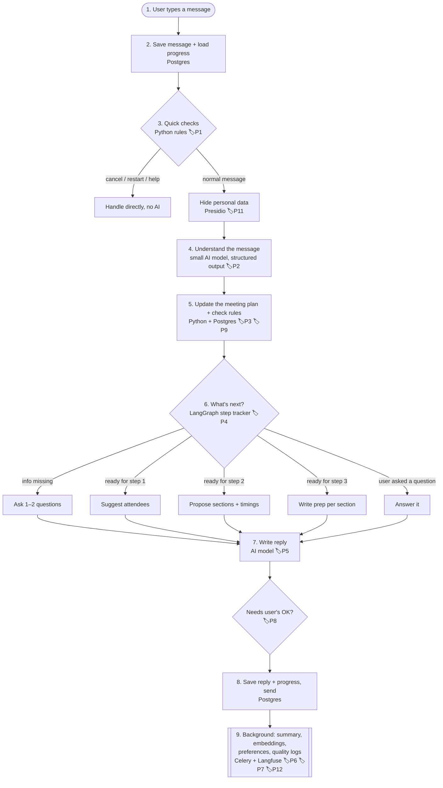
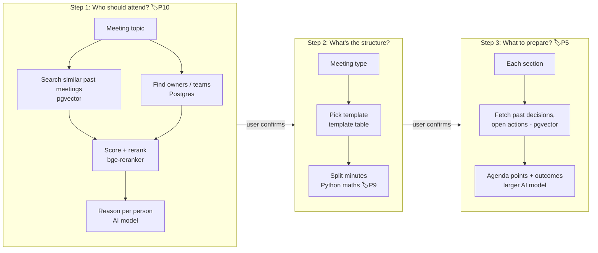
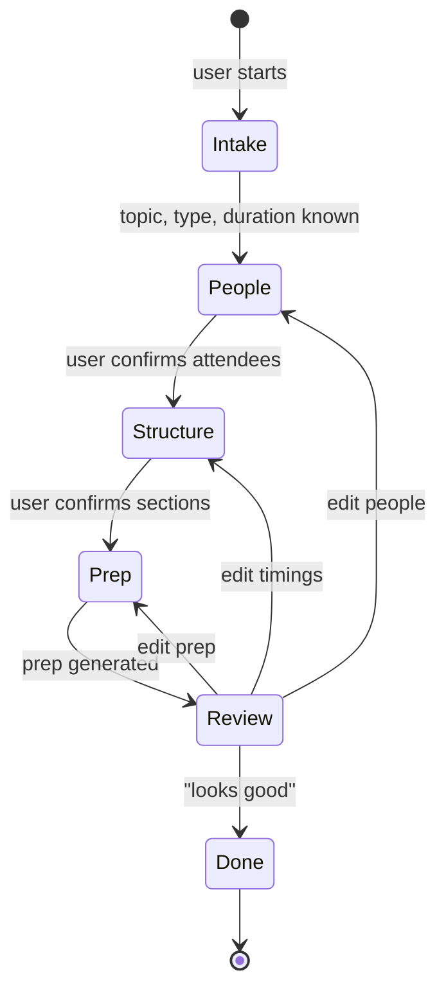
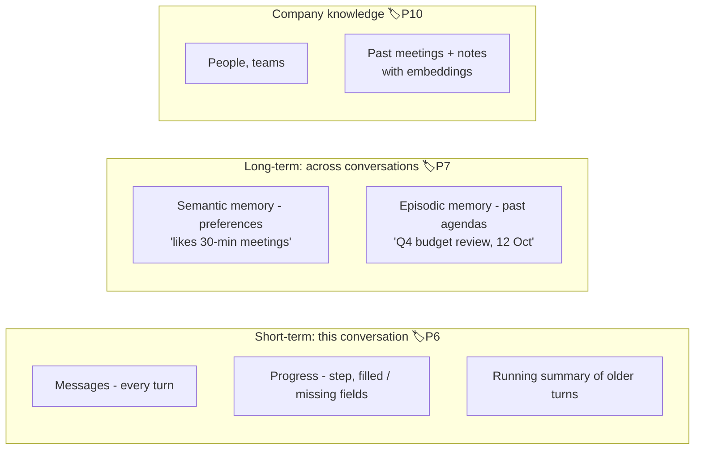

# Agenda Bot: High-Level Flow (for managers)

**What it does:** the user chats with the bot about a meeting they're planning. The bot asks for what it needs and builds three things:
1. **Who should attend** (suggested people)
2. **Meeting structure** (sections and minutes for each)
3. **What to prepare** (agenda points and expected outcomes for each section)

> Diagrams use Mermaid. In Google Docs, use a Mermaid add-on or paste each block into mermaid.live and insert the image.
> 🏷️ tags in the diagrams link to the **Design choices** table in section 8, which shows the industry pattern we follow at each point.

---

## 1. The big picture



---

## 2. What happens when a user sends a message



---

## 3. What each step calls



**Example replies:**
- Step 1: "I suggest Priya (owns Q1 budget), Raj (attended last 3 reviews)… OK?"
- Step 2: "Recap 5 · Options 15 · Discussion 15 · Decision 10 = 45 min. Changes?"
- Step 3: "Options: present 3 budget scenarios → outcome: shortlist 1…"

---

## 4. Steps of the conversation


If an earlier step changes, later steps are marked "needs update" and the bot offers to refresh them. Edits the user made by hand are never overwritten.

---

## 5. Decision rules: "if this, then that"

| If the user's message... | The bot... | Uses | Pattern |
|---|---|---|---|
| Says cancel / start over / help | Handles it directly | Python rules | P1 |
| Gives meeting details | Saves them and asks for anything missing | Small AI model + Postgres | P2, P3 |
| Is missing must-have info | Asks 1–2 short questions | LangGraph | P3, P4 |
| Has enough info for people | Suggests attendees | pgvector + reranker + AI | P10 |
| Confirms the people | Proposes sections and timings | Templates + Python | P8, P9 |
| Changes a time or section | Rechecks timings, shows the update | Python | P9 |
| Confirms the structure | Writes prep for each section | Larger AI + pgvector | P5 |
| Asks something ("should I add a demo?") | Answers it, then continues | AI model | P2 |
| Refers to something said earlier | Finds it in saved progress, or searches the chat | Postgres (+ pgvector) | P6 |
| Says "looks good" at the end | Finalises the agenda | Postgres | P8 |

---

## 6. What gets stored (memory)



| Stored item | Where | Why |
|---|---|---|
| Every message | Postgres `messages` | History, debugging, quality checks |
| Conversation progress | Postgres `conversations` | So the bot knows where it is |
| Meeting plan (people, sections, prep) | Postgres plan tables | The actual result |
| Preferences (semantic memory) | Postgres `user_memory` | Better defaults next time |
| Past agendas (episodic memory) | Postgres + pgvector | "Same as last budget review" |
| Company knowledge + embeddings | Postgres + pgvector | Find relevant people and history |

**What an embedding is:** a numeric fingerprint of text's meaning. It lets the bot find "similar" meetings even when the words differ.

---

## 7. Building blocks (all open source)

| Block | Tool | Job in one line |
|---|---|---|
| Conversation flow | **LangGraph** | Tracks the step and decides what's next |
| AI model | **Qwen3** on **vLLM** | Understands messages, writes replies and prep |
| Database | **PostgreSQL** | Stores everything |
| Similarity search | **pgvector** + **BGE-M3** + **bge-reranker** | Finds related people, meetings and notes |
| Data checks | **Pydantic** + Python | Makes sure AI output is valid |
| Privacy | **Presidio** | Hides personal data |
| Background jobs | **Celery** | Summaries and embeddings without slowing the chat |
| Quality | **Langfuse** + **promptfoo** / **DeepEval** | Records every turn; tests that changes don't break things |

---

## 8. Design choices: which industry pattern we use, and why

| # | Decision point | ✅ What we use (industry pattern) | ❌ Instead of | Why we chose it | Who else does this |
|---|---|---|---|---|---|
| **P1** | Handling "cancel / help / restart" | **Rule-based pre-router**: cheap deterministic checks before any AI | Sending every message to an LLM | Instant, free and predictable for fixed commands | Common in production bots; Anthropic's "routing" pattern allows non-LLM classifiers |
| **P2** | Understanding the message | **LLM structured extraction**: one call returns all facts and questions as a list | **Embedding router** (picks one nearest intent) or **LLM intent classifier** | Our bot fills a form, it isn't choosing between 20 intents. Users give several details and questions in one message, which an embedding router can't split. Extraction does the routing as well. | Rasa CALM "command generator", OpenAI Structured Outputs |
| **P3** | Collecting meeting details | **Schema-driven slot filling**: the template defines required and optional fields; the bot asks only for what's missing | Fixed question-by-question script, or free-form chat with no schema | Natural conversation, never asks for something already given, and "done" is objectively checkable | Dialogflow CX forms, Rasa flows/slots |
| **P4** | Controlling the flow | **Workflow with gates** (a state machine of steps, which the AI can't skip) | **Fully autonomous agent** deciding everything | Predictable, testable and auditable. The steps are known in advance. | Anthropic "Building effective agents": prefer workflows when steps are known |
| **P5** | Writing replies and prep | **RAG**: retrieve past decisions and notes, then generate | Letting the AI write from general knowledge | Grounded in real company history, fewer made-up facts | Standard RAG (Lewis et al.); LinkedIn and Airbnb GenAI assistants |
| **P6** | Remembering this conversation | **Structured state + last N turns + running summary** (context engineering) | Sending the whole chat history every time | Lower cost, faster, more accurate (models miss facts in the middle of long prompts) | Anthropic context engineering, "Lost in the Middle", LangGraph checkpointers |
| **P7** | Remembering across conversations | **Semantic memory** (preferences, updated) + **episodic memory** (past agendas, append-only) | No memory, or dumping all old chats into the prompt | Personal defaults without bloating prompts; the user can view and delete it | ChatGPT memory, Mem0, MemGPT |
| **P8** | Moving between steps | **Human-in-the-loop confirmation** at each step | Auto-generating everything in one go | The user keeps control; errors are caught early, before effort is wasted on later steps | LangGraph interrupts; standard for action-taking agents |
| **P9** | Timings and validation | **Deterministic code for rules and maths**; the AI only proposes | Trusting the AI to add minutes correctly | AI is unreliable at exact arithmetic and constraints; code is never wrong here | Anthropic: put checks in tools, not prompts |
| **P10** | Suggesting attendees | **Retrieve, then rerank** (two-stage recommendation) + AI explanation | Asking the AI "who should attend?" directly | Uses real data (owners, past attendance), scales to large orgs, explainable | The standard two-stage recommender design used across search and recommendation systems |
| **P11** | Privacy | **PII redaction before storing and before the AI** | Sending raw text everywhere | Compliance, and less sensitive data leaves the app | Microsoft Presidio; common in customer-service bots |
| **P12** | Quality | **Tracing + evals with simulated users** in CI | Manual spot-checking | Catches regressions when prompts or models change | Langfuse, promptfoo / DeepEval; LLM-as-judge practice |

### Where we might switch patterns later

| If this happens… | Switch to |
|---|---|
| The bot grows to handle many unrelated tasks (scheduling, notes, follow-ups) | Add an **embedding router** (fast, cheap) in front, with an **LLM router fallback** for unclear cases |
| Conversations get very long | Add **retrieval over chat history** (pgvector on messages) alongside the summary |
| One step becomes heavy (e.g. analysing 20 past meetings) | Make it a **sub-agent used as a tool** (orchestrator-workers pattern) |
| Company data grows to tens of millions of vectors | Move vectors from pgvector to **Qdrant** |

---

## 9. A sample conversation

```mermaid
sequenceDiagram
    actor U as User
    participant B as Agenda Bot
    U->>B: Need a 45 min meeting next Tue to decide Q1 budget. Add Priya.
    Note over B: P2 extract: type=decision, 45 min, Tue, Priya
    B->>U: What's the one decision you need by the end?
    Note over B: P3 missing field: objective
    U->>B: Approve final Q1 budget split.
    Note over B: P10 retrieve + rerank people
    B->>U: Suggested: Priya (finance owner), Raj (ran last 3 reviews), Meera. OK?
    U->>B: Remove Meera.
    Note over B: P8 confirmed → P9 split minutes
    B->>U: Recap 5 · Options 15 · Discussion 15 · Decision 10. OK?
    U->>B: Discussion 10, decision 15.
    Note over B: P9 recheck = 45 ✔ → P5 RAG prep
    B->>U: Prep: Options → 3 scenarios → shortlist 1; Decision → signed-off budget. Finalise?
    U->>B: Looks good.
    B->>U: Agenda finalised ✅
```

---

*Sources for every pattern are in `citations.md` (Anthropic, Rasa, Dialogflow CX, OpenAI, LinkedIn, Airbnb, Lost in the Middle, MemGPT, Mem0, ChatGPT memory, pgvector, Langfuse).*
