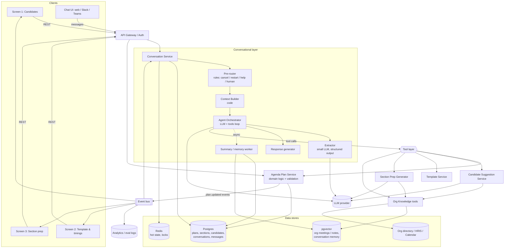
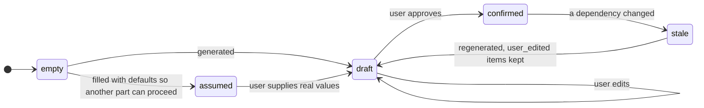
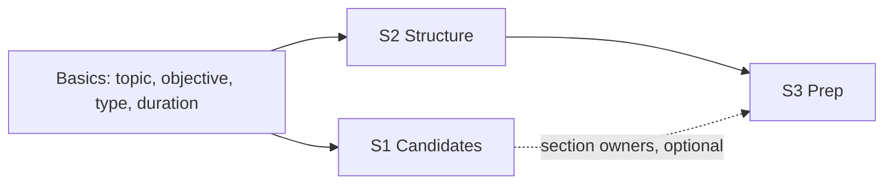
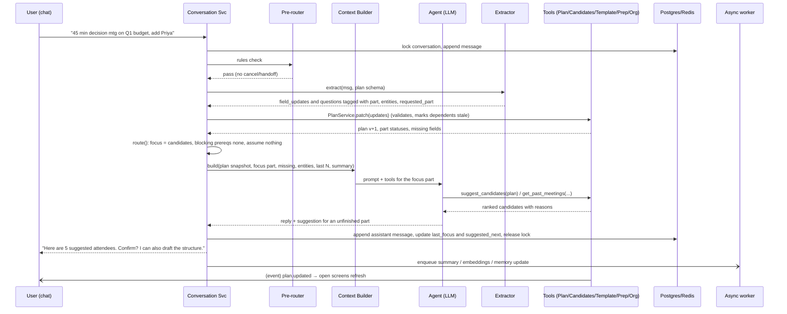
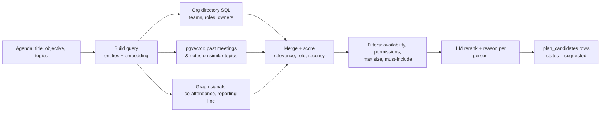
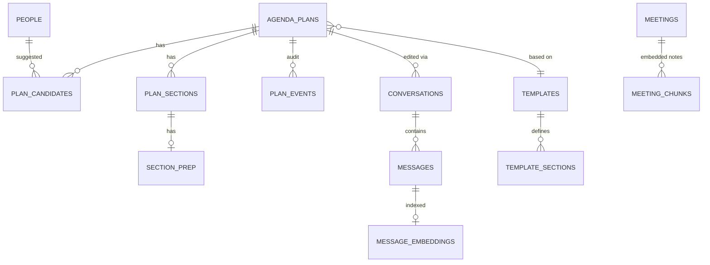
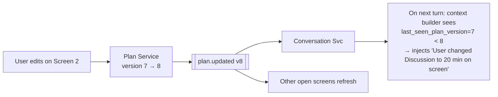
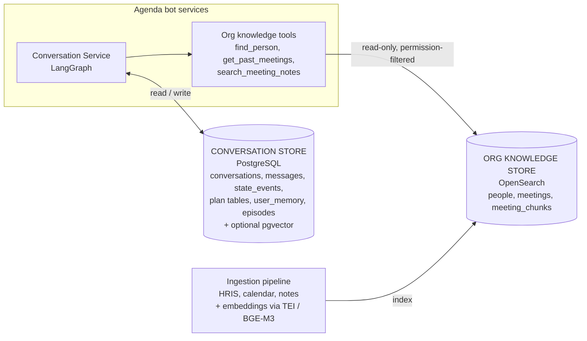

# Agenda Bot: End-to-End Architecture (Conversational + Existing Screens)

## 1. Goal and the key design decision

Today the product has three separate UI screens. We're adding a conversational flow **without losing the ability to serve each screen on its own**.

| Stage | Existing screen | Output artifact |
|---|---|---|
| S1 | Agenda → **suggested candidates (attendees)** | `plan_candidates` |
| S2 | **Meeting template**: sections + timings, user-editable | `plan_sections` |
| S3 | **Per-section agenda and expected outcomes** for the meeting creator to prepare with | `section_prep` |

**Key decision:** both the chat and the screens are *clients* of one **Agenda Plan domain service**. The conversation never owns the data. It reads and writes the same `agenda_plan` record that the screens use, through the same APIs, which become the agent's **tools**.

As a result:
- A user can start in chat and finish on the screens, or the other way round. Both see the same plan.
- Each stage's output is stored on its own, so each screen keeps working unchanged.
- Validation and business rules live in **one place**: the domain service, not the prompt.

---

## 2. High-level architecture



### Components

| Component | Type | Responsibility |
|---|---|---|
| **Agenda Plan Service** | Deterministic code | Source of truth for a plan and its stages. Validation (e.g. section minutes ≤ duration), stage status, versioning. Exposes the REST APIs that screens use **and** the agent uses as tools. |
| **Conversation Service** | Code | Stores conversations and messages, per-conversation lock, runs the turn loop. |
| **Pre-router** | Rules | Cheap exits: "cancel", "start over", "help", "talk to a person", plus PII and safety checks. No LLM call. |
| **Context Builder** | Code | Assembles the prompt: system prompt, plan snapshot, stage + missing fields, entities, pending questions, last N turns, summary. |
| **Agent Orchestrator** | LLM loop | Decides what to do next: call tools, ask the user, or confirm. A single agent with tools is enough here. |
| **Extractor** | Small LLM, structured output | Turns a message into `field_updates[]`, `questions[]`, `entities[]`, `notes[]`, `intent_shift`. |
| **Candidate Suggestion Service** | Retrieval + ranking (+ LLM rerank) | S1: agenda → ranked attendees with a reason for each. |
| **Template Service** | Code + LLM | S2: picks a template by meeting type and proposes sections and timings. |
| **Section Prep Generator** | LLM (+ org knowledge) | S3: writes the agenda points and expected outcomes for each section, plus prep notes. |
| **Org Knowledge tools** | SQL + pgvector | `find_person`, `get_past_meetings`, `search_meeting_notes`, `get_open_action_items`, `get_availability`. Permission-filtered. |
| **Summary / memory worker** | Async LLM | Running summary, long-term user preferences, conversation embeddings. |
| **Event bus** | Infra | `plan.updated` keeps open screens and the chat in sync. |

---

## 3. Conversation flow: user-led, dependency-gated (mixed initiative)

> **Design change:** this replaces the earlier strict stage sequence (Intake → S1 → S2 → S3). Users don't think in stages: they may ask about attendees, the structure or the prep first. The bot works on whatever part the user brings up and only *suggests* an unfinished part when the user hasn't said what they want.

### 3.1 Parts, statuses and dependencies

The plan has **basics** (title, objective, meeting_type, duration, date) and three **parts**: S1 candidates, S2 structure, S3 prep. Each part has its own status in `agenda_plans.stage_status`:





| Part | Prerequisites | If missing |
|---|---|---|
| S1 Candidates | topic or objective | **Ask** (can't be guessed) |
| S2 Structure | meeting_type, duration_min | **Assume**: type inferred from objective, duration from user preference or 30 min. Mark the fields `assumed`. |
| S3 Prep | objective + S2 sections | **Auto-draft** S2 from the template (status `assumed`), then generate prep |

The plan is **finalisable** when S1, S2 and S3 are all `confirmed`. If the user finalises earlier, list what is still `assumed` or `draft`.

### 3.2 Router logic (LangGraph conditional edge, pure Python)

```python
PREREQS = {
    "candidates": {"ask":    ["topic_or_objective"]},
    "structure":  {"assume": ["meeting_type", "duration_min"]},
    "prep":       {"ask":    ["topic_or_objective"],
                   "assume": ["meeting_type", "duration_min"],
                   "needs_parts": ["structure"]},
}
ORDER = ["candidates", "structure", "prep"]   # used only to sort several focuses, and for suggestions

def route(state, extraction, plan):
    # 1. questions are always answered (same reply)
    answer_q = bool(extraction.questions)

    # 2. focus = parts this message touches (the extractor tags each update/question with a part)
    focus = sorted({u.part for u in extraction.field_updates if u.part} |
                   {q.part for q in extraction.questions if q.part}, key=ORDER.index)
    if not focus and extraction.requested_part:          # "give me an agenda"
        focus = [extraction.requested_part]
    if not focus:                                        # "hi", "ok", "thanks"
        focus = [next_unfinished(plan)]                  # suggestion only

    # 3. prerequisites for the first focus part
    part = focus[0]
    blocking = [f for f in PREREQS[part].get("ask", []) if missing(plan, f)]
    if blocking:
        return {"action": "ask", "field": blocking[0], "answer_q": answer_q}   # ONE question
    for f in PREREQS[part].get("assume", []):
        if missing(plan, f):
            plan.assume(f)                               # status = assumed, told to the user
    for p in PREREQS[part].get("needs_parts", []):
        if plan.part_status(p) == "empty":
            plan.autodraft(p)                            # e.g. S2 from template, status = assumed

    # 4. produce the part, 5. suggest the next unfinished part in the reply
    return {"action": f"run_{part}", "answer_q": answer_q, "suggest": next_unfinished(plan, exclude=part)}
```

- **One blocking question per turn at most.** Everything else is assumed and shown to the user, so they can correct it.
- **Volunteered information** for any part is always saved by the extractor, whatever the focus.
- **Extraction schema change:** `FieldUpdate` and questions get a `part` field (`basics | candidates | structure | prep | null`), and `Extraction` gets `requested_part`.

### 3.3 Staleness (built by us, not a framework feature)

LangGraph, Rasa and Dialogflow CX don't track dependencies between generated parts, so this is our own code in the Plan Service (*dependency tracking with invalidation*):

```python
DEPENDS = {
    "objective":    ["candidates", "structure", "prep"],
    "topic":        ["candidates", "prep"],
    "meeting_type": ["structure", "prep"],
    "duration_min": ["structure", "prep"],
    "attendees":    ["prep"],          # section owners
    "sections":     ["prep"],          # only the changed sections' prep
}
def on_plan_update(changed_fields):
    for f in changed_fields:
        for part in DEPENDS.get(f, []):
            if plan.part_status(part) in ("draft", "confirmed"):
                plan.mark(part, "stale")      # bot offers: "Duration changed, rebalance timings?"
# Regeneration skips any row with source = 'user_edited'.
```

**Pattern:** *mixed-initiative dialogue* (either side can lead) plus *prerequisite-driven slot filling with defaults*, keeping control in code. Dialogflow CX route groups offer similar "jump from anywhere" behaviour, but the per-part statuses and dependencies are custom.

---

## 4. Turn sequence (one user message)



Here the message is about attendees, so the focus is S1. If the user had asked "what should I prepare?", the router would have picked S3, assumed the structure, and run prep instead. See section 3.2.

**Main practices:**
- **Extract, then validate in code, then route on the focus, then respond.** The LLM proposes changes; the Plan Service decides whether they're valid.
- The agent writes to the plan **only through tools**, never as free text.
- **Lock per conversation** plus `plan.version` with optimistic concurrency, so chat and screen edits don't overwrite each other.

---

## 5. How each part works (any order, whichever the user asks for)

### S1: Candidate suggestion

- Every candidate is stored with a **reason** and **source signals**. Screen 1 shows them; the chat explains them.
- User actions (accept, reject, add manually) are stored per row, which gives you feedback data for improving ranking.

### S2: Template, sections and timings
- Inputs: `meeting_type`, `duration_min`, objective, and number of attendees.
- The Template Service picks a base template (from your template library), then the LLM adapts its sections. **Code enforces** `sum(section.minutes) == duration_min` (or ≤ it, with a buffer).
- Sections are stored as **individual rows**, so Screen 2 edits (reorder, rename, change minutes) and chat edits ("make discussion 20 min") hit the same rows.

### S3: Per-section agenda and outcomes
- For each section: `agenda_points[]`, `expected_outcomes[]`, `owner`, `prep_notes`, `pre_reads[]`, all generated with org context (past decisions, open action items).
- Generated **per section**, so editing one section only regenerates that section.
- Each item carries `source: generated | user_edited`. **User-edited content is never overwritten** by regeneration unless the user asks.

---

## 6. Data model

Two groups of data: **domain data** (shared with the screens) and **conversation data** (chat only).



### 6.1 Domain tables (serve the screens and the chat)

```sql
CREATE TABLE agenda_plans (
  plan_id        UUID PRIMARY KEY,
  owner_user_id  TEXT NOT NULL,
  title          TEXT,
  objective      TEXT,
  meeting_type   TEXT,              -- kickoff | status | decision | brainstorm | 1on1 | review
  duration_min   INT,
  scheduled_at   TIMESTAMPTZ,
  template_id    UUID,
  status         TEXT,              -- active | finalized   (no fixed stage order; see section 3)
  stage_status   JSONB,             -- per part: {"basics":"assumed","candidates":"confirmed","structure":"stale","prep":"draft"}
                                    -- values: empty | assumed | draft | confirmed | stale
  created_via    TEXT,              -- ui | chat
  version        INT NOT NULL DEFAULT 0,   -- optimistic locking (chat + UI)
  created_at TIMESTAMPTZ, updated_at TIMESTAMPTZ
);

-- Screen 1
CREATE TABLE plan_candidates (
  plan_id      UUID REFERENCES agenda_plans,
  person_id    TEXT,
  role_in_mtg  TEXT,               -- decision_maker | contributor | informed
  score        REAL,
  reason       TEXT,               -- "Owns Q1 budget; attended last 3 budget reviews"
  signals      JSONB,              -- {"topic_sim":0.82,"co_attend":5,"team":"finance"}
  status       TEXT,               -- suggested | accepted | rejected | added_by_user
  source       TEXT,               -- generated | user
  updated_at   TIMESTAMPTZ,
  PRIMARY KEY (plan_id, person_id)
);

-- Screen 2
CREATE TABLE plan_sections (
  section_id   UUID PRIMARY KEY,
  plan_id      UUID REFERENCES agenda_plans,
  position     INT,
  name         TEXT,               -- Recap | Discussion | Decisions | Action items ...
  minutes      INT,
  owner_person_id TEXT,
  source       TEXT,               -- template | generated | user_edited
  status       TEXT,               -- active | stale
  updated_at   TIMESTAMPTZ
);

-- Screen 3
CREATE TABLE section_prep (
  section_id        UUID PRIMARY KEY REFERENCES plan_sections,
  agenda_points     JSONB,         -- ["Review Q1 spend vs plan", ...]
  expected_outcomes JSONB,         -- ["Approve revised budget", ...]
  prep_notes        TEXT,
  pre_reads         JSONB,         -- [{title, url}]
  source            TEXT,          -- generated | user_edited
  status            TEXT,          -- fresh | stale
  generated_with    JSONB,         -- model, prompt version, sources used
  updated_at        TIMESTAMPTZ
);

CREATE TABLE plan_events (          -- audit: who changed what, from where
  plan_id UUID, version INT, actor TEXT,        -- user_id | agent
  channel TEXT,                                  -- ui | chat
  entity TEXT, entity_id TEXT, change JSONB,
  conversation_id UUID, message_seq INT,         -- link back to the chat turn, if any
  created_at TIMESTAMPTZ
);

-- Template library
CREATE TABLE templates (template_id UUID PRIMARY KEY, meeting_type TEXT, name TEXT, version INT);
CREATE TABLE template_sections (template_id UUID, position INT, name TEXT,
                                default_pct REAL, required BOOL, guidance TEXT);
```

### 6.2 Conversation tables (chat only)

```sql
CREATE TABLE conversations (
  conversation_id  UUID PRIMARY KEY,
  user_id          TEXT NOT NULL,
  plan_id          UUID REFERENCES agenda_plans,   -- the plan this chat is editing
  status           TEXT,
  state            JSONB,          -- conversational state only (see 6.3), NOT plan data
  state_version    INT DEFAULT 0,
  summary          TEXT, summary_upto_seq INT,
  created_at TIMESTAMPTZ, updated_at TIMESTAMPTZ
);

CREATE TABLE messages (             -- append-only
  conversation_id UUID REFERENCES conversations, seq INT,
  role TEXT, content TEXT, content_redacted TEXT,
  tool_name TEXT, tool_args JSONB, tool_result JSONB,
  extracted JSONB,
  model TEXT, prompt_tokens INT, completion_tokens INT, latency_ms INT,
  created_at TIMESTAMPTZ,
  PRIMARY KEY (conversation_id, seq)
);

CREATE TABLE message_embeddings (   -- optional; mainly for long-term memory
  conversation_id UUID, seq INT, user_id TEXT, chunk_text TEXT,
  embedding VECTOR(1536), model TEXT, created_at TIMESTAMPTZ,
  PRIMARY KEY (conversation_id, seq)
);
```

### 6.3 What goes in `conversations.state` vs the plan tables

**Rule:** if a screen needs it, it lives in the **plan tables**. `conversations.state` holds only what the *conversation* needs.

```jsonc
{
  "last_focus": ["prep"],                   // part(s) the latest message was about
  "suggested_next": "candidates",           // what the bot offered to do next (a suggestion, not a gate)
  "field_status": {                         // inferred / assumed / confirmed, for basics
    "objective": {"status": "inferred", "evidence": [{"seq": 2, "quote": "need finance on board"}]}
  },
  "entities": [{"type": "person", "name": "Priya", "resolved_person_id": "p_42"}],
  "pending_questions": [{"seq": 9, "text": "suggest an icebreaker", "answered": false}],
  "pending_confirmation": {"stage": "candidates", "proposal_ref": "plan_v7"},
  "notes": ["worried about pushback from finance"],
  "standing_instructions": [                // rules the user stated once, injected into every prompt
    {"text": "always add a 5-min buffer at the end", "scope": "user", "source_seq": 4, "active": true}
  ],
  "last_seen_plan_version": 7               // detect edits made on screens meanwhile
}
```

**Standing instructions:** the extractor also returns `standing_instructions[]` ("always…", "from now on…", "never…"). `scope: conversation` rules live here; `scope: user` rules are copied to `user_preferences` / `user_memory` (type `instruction`) so they apply to future plans. The context builder injects all active rules into every prompt, so they survive trimming of the last-N turns. Rules that map to deterministic actions (e.g. the buffer) are applied by the Plan Service in code. See `conversational_bot_design.md` section 7b.

### 6.4 Org knowledge (read-only, used through tools)

```sql
-- people(person_id, name, title, team, manager_id, email, skills[], ...)  -- from HRIS/directory
-- meetings(meeting_id, title, date, organizer, attendees[], decisions JSONB, action_items JSONB)
-- meeting_chunks(meeting_id, chunk_no, text, embedding VECTOR(1536))
-- user_preferences(user_id, key, value, source, updated_at)  -- e.g. default_duration, likes_icebreakers
CREATE INDEX ON meeting_chunks USING hnsw (embedding vector_cosine_ops);
```

---

## 7. Agent tools (the same APIs the screens call)

| Tool | Backed by | Used in |
|---|---|---|
| `get_plan(plan_id)` | Plan Service | Every turn (context builder) |
| `update_plan_fields(plan_id, updates, expected_version)` | Plan Service | Intake + edits |
| `suggest_candidates(plan_id, constraints)` | Candidate Service | S1 |
| `set_candidate_status(plan_id, person_id, status)` | Plan Service | S1 |
| `propose_template(plan_id)` | Template Service | S2 |
| `update_section(plan_id, section_id, {name, minutes, position})` | Plan Service | S2 |
| `rebalance_timings(plan_id)` | Plan Service (code) | S2 |
| `generate_section_prep(plan_id, section_ids[])` | Prep Generator | S3 |
| `update_section_prep(section_id, patch)` | Plan Service | S3 |
| `find_person(query)` / `get_past_meetings(...)` / `search_meeting_notes(...)` / `get_availability(...)` | Org Knowledge | S1, S3 |
| `finalize_plan(plan_id)` | Plan Service | Review |

These can be exposed to the agent through function calling, or through an **MCP server** so other agents can reuse them.

---

## 8. Keeping chat and screens in sync


- The chat **always reads the latest plan** through `get_plan` when building context, so it never relies on a stale copy.
- A write with an old `expected_version` gets `409 Conflict`. The agent re-reads the plan and retries, or asks the user.

---

## 9. Context per turn (what's sent to the LLM)

| Part | Source | Budget |
|---|---|---|
| System prompt + stage instructions | Static, versioned | Cached |
| Plan snapshot (compact) | `get_plan` (current stage in full, other stages summarised) | ~300–800 tokens |
| Missing / stale / inferred fields | Plan Service + `conversations.state` | Small |
| Entities, pending questions, notes | `conversations.state` | Small |
| Last N turns (N≈6) | `messages` | ~1–2k |
| Running summary | `conversations.summary` | ~300 |
| Tool results | This turn only | Remaining |

---

## 10. Cross-cutting concerns

- **Evals:** a set of simulated-user scenarios (vague user, everything at once, changes mind, edits mid-chat on a screen). Metrics: stage completion, turns to complete, timing validity, candidate acceptance rate, prep edit rate.
- **Observability:** log the exact context, tool calls, versions and latency for each turn (`messages` + `plan_events`).
- **Safety and permissions:** org tools filter by the requester's access, PII is redacted in `content_redacted`, and no calendar invites are sent without explicit confirmation.
- **Cost and latency:** a small model for extraction and summaries, a stronger model for prep generation, and prompt caching for the system prompt and template definitions.
- **Rollout:** ship the Plan Service APIs first (the screens already need them), then chat as another client. Use a feature flag per user, and stay able to go from chat to the screens and back.

---

## 11. Build order

1. Extract the **Agenda Plan Service** from the current screens (stage tables, versioning, events).
2. Wrap the S1/S2/S3 logic as services with clean APIs, and define the agent tools on top of them.
3. Conversation Service: tables, locking, pre-router, context builder.
4. Extractor + agent loop for **Intake → S1** first, then S2, then S3.
5. Sync events, stale-marking, review/finalize.
6. Evals, the summary worker, long-term preferences.

> **Where this comes from:** the patterns follow the sources in `citations.md`: tool-based agents and routing (Anthropic), slot/form flows (Rasa CALM, Dialogflow CX), structured extraction (OpenAI Structured Outputs), state and message storage (Rasa tracker store, LangGraph checkpointers, Discord), pgvector retrieval, and context engineering (Anthropic). The specific services, tables and field names are a reference design for this product.

---

## 12. Open-source technology stack per stage (what, why, how)

> **Constraint:** open-source only (OSI-approved or equivalently permissive licences, self-hostable).
> **Licences change:** the licences listed were checked in Nov 2026 from public sources. Confirm the LICENSE file of the exact version you install, and get your legal team's view on AGPL.

### 12.1 Recommended stack at a glance

| Stage / layer | Primary pick | Licence | Alternatives (OSS) |
|---|---|---|---|
| Chat UI (web) | Your existing React app + a chat component (e.g. assistant-ui, or a custom one) | MIT | Chatwoot widget (MIT core), Botpress webchat |
| Slack/Teams channel | Bolt for Python/JS (Slack), Bot Framework SDK (Teams) | MIT | — |
| API / services | FastAPI (Python) | MIT | Django, NestJS |
| Agent orchestration + stage state machine | **LangGraph** | MIT | Haystack (Apache 2.0), LlamaIndex Workflows (MIT), PydanticAI (MIT) |
| Structured extraction | **Pydantic** schemas + vLLM guided JSON / tool calling (or Instructor) | MIT / Apache 2.0 | Outlines (Apache 2.0), BAML |
| Pre-router (rules) | Plain Python rules + regex | — | — |
| Semantic router (optional) | **semantic-router** (Aurelio) | MIT | Custom pgvector nearest-neighbour |
| LLM (self-hosted) | **Qwen3 family** (e.g. 8B–32B / 30B-A3B; Apache 2.0 checkpoints) | Apache 2.0 | Mistral Apache-licensed models, gpt-oss (Apache 2.0) |
| LLM serving | **vLLM** | Apache 2.0 | SGLang (Apache 2.0), Ollama (MIT) for local development |
| Model gateway (routing, fallbacks, keys) | **LiteLLM** (OSS core) | MIT (core) | — |
| Embeddings | **BGE-M3** or e5 / gte models | MIT / Apache 2.0 | Nomic embed (Apache 2.0) |
| Embedding serving | **Hugging Face TEI** or sentence-transformers | Apache 2.0 | Infinity (MIT) |
| Reranker (candidate + notes retrieval) | **bge-reranker** | Apache 2.0 | — |
| Relational DB | **PostgreSQL** | PostgreSQL licence | — |
| Vector search | **pgvector** (same Postgres) | PostgreSQL licence | Qdrant (Apache 2.0) at larger scale |
| Keyword / hybrid search | Postgres full-text (`tsvector`) | — | ParadeDB pg_search (AGPL), OpenSearch (Apache 2.0) |
| Hot state, locks, cache | **Valkey** | BSD-3 | Redis 8 (AGPLv3 / RSAL / SSPL tri-licence) |
| Event bus (`plan.updated`) | **NATS** or Postgres LISTEN/NOTIFY to start | Apache 2.0 | Apache Kafka (Apache 2.0) |
| Async workers | **Celery** or Dramatiq | BSD / LGPL | Temporal (MIT) for durable long workflows |
| Org-data ingestion (HRIS, calendar, notes) | Python ETL + **Unstructured** for documents | Apache 2.0 | Apache Airflow (Apache 2.0), Dagster (Apache 2.0) |
| Tool exposure | **MCP Python SDK** (optional) | MIT | Plain function calling |
| PII detection / redaction | **Microsoft Presidio** | MIT | — |
| Guardrails | **NeMo Guardrails** and/or **Guardrails AI** | Apache 2.0 | LLM Guard (MIT) |
| Tracing / observability | **Langfuse** (self-hosted core) + OpenTelemetry | MIT (core) | Arize Phoenix (Elastic licence 2.0, not OSI), MLflow (Apache 2.0) |
| Evals | **promptfoo**, **DeepEval**, **Ragas** | MIT / Apache 2.0 / Apache 2.0 | — |
| Long-term memory (optional) | Own tables (section 6), or **Mem0** OSS | Apache 2.0 | Letta (Apache 2.0) |
| Metrics / dashboards | Prometheus + Grafana | Apache 2.0 / AGPLv3 | — |

### 12.1a Main choices per stage and why (summary)

| Stage / layer | Pick | Why |
|---|---|---|
| Conversation flow (Intake → S1 → S2 → S3 → Review) | **LangGraph** (MIT) | The flow is a state machine. LangGraph models it directly, stores conversation state in Postgres, and can pause at each stage until the user confirms. |
| Pulling details out of messages | **Pydantic + vLLM structured output** | Output is checked against a typed schema, including lists, so one message can update several fields and ask several questions. |
| LLM and serving | **Qwen3 Apache-2.0 models on vLLM, with LiteLLM in front** | Open models under a permissive licence with good tool calling; LiteLLM sends extraction to a small model and prep writing to a larger one. |
| S1 suggesting attendees | **Postgres + pgvector, BGE-M3 embeddings, bge-reranker** | People, past meetings and vectors are searched together in one SQL query; the reranker improves the ordering. |
| S2 template timings | **Plain Python, templates stored in tables or YAML** | Making minutes add up exactly is arithmetic, not an LLM job. |
| S3 section prep | **Larger LLM, given relevant past meeting notes** | One call per section, run in parallel; sections the user edited are skipped. |
| Locks, cache, events | **Valkey** (BSD), **NATS**; or Postgres alone at first | Valkey works like Redis without Redis 8's AGPL/SSPL licence question. |
| Safety | **Presidio** (PII), **NeMo Guardrails** | Masks personal data before storage and LLM calls; keeps the bot on topic. |
| Tracing and testing | **Langfuse** (self-hosted), **promptfoo / DeepEval / Ragas** | Traces every turn; evals run in CI so a prompt change can't silently make things worse. |

**Why not Rasa:** Rasa's LLM-based engine (CALM) is only in Rasa Pro, which needs a licence key, so it isn't open source. Rasa Open Source is reportedly in maintenance mode. It's still an option as a classic intent classifier for a high-volume customer-service bot.

**Open but not open source:** Llama models (Meta community licence) and Arize Phoenix (Elastic licence 2.0) aren't under OSI-approved licences, so avoid them in an OSS-only build.

### 12.2 Why each choice, and how to implement it

#### A. Agent orchestration: LangGraph (and why not Rasa)
**Why LangGraph**
- Your flow *is* a state machine (Intake → S1 → S2 → S3 → Review), and LangGraph models it directly as a graph of nodes and edges with typed state.
- Built-in **checkpointers** (Postgres) give you conversation-state persistence, resume after a crash, and human-in-the-loop "interrupt and wait for confirmation", which matches your stage gates.
- Works with any model, including self-hosted vLLM, and you can mix deterministic code nodes with LLM nodes.
- MIT licence. You don't need the paid LangGraph Platform: run it inside your FastAPI service.

**Why not Rasa as the core**
- Rasa's modern LLM engine (**CALM**) is in **Rasa Pro**, which needs a licence key. The free Developer Edition has conversation limits, so it isn't open source.
- Rasa Open Source (the classic NLU + stories stack) is reportedly in maintenance mode and built for intent/entity bots, not LLM-native slot-filling over a rich schema.
- **Where Rasa OSS could still fit:** as a classic intent classifier (DIET) for a high-volume customer-service bot with stable intents. For the agenda bot, Pydantic + LLM extraction is simpler.

**How (sketch)**
```python
from typing import TypedDict, Literal
from langgraph.graph import StateGraph, END
from langgraph.checkpoint.postgres import PostgresSaver

class ConvState(TypedDict):
    plan_id: str
    stage: Literal["intake","candidates","template","prep","review","final"]
    last_extraction: dict
    pending_questions: list
    entities: list

g = StateGraph(ConvState)
g.add_node("pre_route", pre_route)          # rules: cancel/restart/help
g.add_node("extract",   extract_updates)    # small LLM -> Pydantic
g.add_node("apply",     apply_to_plan)      # PlanService.patch (validation in code)
g.add_node("agent",     agent_step)         # LLM + tools for the current stage
g.add_node("confirm",   ask_confirmation)   # interrupt -> wait for user
g.set_entry_point("pre_route")
g.add_edge("pre_route", "extract"); g.add_edge("extract", "apply"); g.add_edge("apply", "agent")
g.add_conditional_edges("agent", next_step, {"confirm": "confirm", "reply": END})
app = g.compile(checkpointer=PostgresSaver.from_conn_string(PG_URL))
# per message: app.invoke({"...": ...}, config={"configurable": {"thread_id": conversation_id}})
```
- `thread_id = conversation_id`, so the checkpointer stores the conversation state per conversation.
- The plan data stays in **your plan tables**. The LangGraph state holds only conversation state (section 6.3).

#### B. Structured extraction: Pydantic + guided decoding
**Why:** you need reliable, machine-validated output (field updates, questions, entities). Pydantic gives typed schemas and validation, and vLLM's guided JSON / structured outputs (or tool calling) make the model emit valid JSON. Instructor adds retry-on-validation-error.

**How**
```python
from pydantic import BaseModel
from typing import Literal, Optional

class FieldUpdate(BaseModel):
    field: str
    op: Literal["set","add","remove"]
    value: Optional[str | int | list]

class Extraction(BaseModel):
    field_updates: list[FieldUpdate] = []
    questions: list[str] = []
    entities: list[dict] = []
    notes: list[str] = []
    intent_shift: Optional[Literal["cancel","restart","new_meeting"]] = None

# vLLM OpenAI-compatible endpoint with JSON-schema guided output
resp = client.chat.completions.create(
    model="qwen3-8b", messages=msgs,
    extra_body={"guided_json": Extraction.model_json_schema()})
ext = Extraction.model_validate_json(resp.choices[0].message.content)
```
- Use a **small model** (e.g. 7–8B) for extraction and a **larger model** (e.g. 30B+) for S3 prep generation.

#### C. LLM + serving: Qwen3 (Apache 2.0) on vLLM, behind LiteLLM
**Why**
- Open weights under Apache 2.0 (check each checkpoint, since some newer flagship Qwen releases use custom licences), with strong tool calling and multilingual support.
- vLLM gives high-throughput serving, an OpenAI-compatible API, guided JSON, and tool-call parsers.
- LiteLLM gives one API across models, model routing (small vs large), fallbacks, and per-team keys and budgets.

**How**
- Run `vllm serve <model> --enable-auto-tool-choice --tool-call-parser <qwen parser>`, one deployment per model size.
- Your services call only LiteLLM, so models can be swapped without code changes.
- **Watch out:** check that tool-call formatting works between the model and the vLLM parser. Some Qwen3 versions use an XML-style tool format, so test parsing in your evals.
- **Avoid for "OSS-only":** Llama models (Meta community licence, not OSI-approved). They are open weights, but not open source by the OSI definition.

#### D. Retrieval for S1 (candidates) and S3 (prep): Postgres + pgvector + BGE
**Why**
- One database for plan data, org data and vectors, so you can join "people in finance who attended similar meetings" in a single SQL query.
- pgvector supports HNSW and filtering, and BGE-M3 gives multilingual dense (and sparse) embeddings.
- bge-reranker improves the top-k ranking for candidates and notes.

**How (candidate suggestion)**
1. Embed the agenda text with TEI and BGE-M3.
2. Run SQL with pgvector: similar `meeting_chunks` → their attendees, plus `people` filtered by team, role or ownership.
3. Score in code: topic similarity, co-attendance, role, recency.
4. Rerank with bge-reranker, then use the LLM to write a one-line reason for each person.
5. Write `plan_candidates` rows with `reason` and `signals`.
- Move to **Qdrant** only if vectors grow to tens of millions or latency becomes a problem. Keep the same IDs.

#### E. Template stage (S2): plain code + YAML templates + LLM adaptation
**Why:** timings must add up exactly, which is a deterministic problem. Templates are versioned data, not prompts.

**How:** store templates in the `templates` and `template_sections` tables (or YAML in git, synced into those tables). The LLM proposes section names and priorities, then **Python allocates the minutes** (e.g. using `default_pct`, rounded to 5 minutes, with any remainder going to the discussion section) and validates the result.

#### F. Prep generation (S3): larger LLM + RAG
**Why:** this needs reasoning over past decisions and open action items, which benefits from a stronger model.

**How:** run one call per section (in parallel with Celery or asyncio), giving it the section, the objective, the attendees and the top-k retrieved past notes. The output is a Pydantic `SectionPrep` schema, written to `section_prep` with `generated_with` metadata. Skip any rows with `source = user_edited`.

#### G. State, cache, locks and events: Valkey + NATS (or Postgres-only at first)
**Why**
- **Valkey** is the BSD-licensed fork of Redis (Linux Foundation). It works as a drop-in for locks (`SET NX PX`), hot state and rate limits, without the AGPL/SSPL question that Redis 8 raises.
- **NATS** is lightweight pub/sub for `plan.updated` events to the screens and the conversation service.
- To start with, **Postgres `LISTEN/NOTIFY`** plus advisory locks can replace both and give you fewer moving parts.

#### H. Async work: Celery (or Temporal)
**Why:** summaries, embeddings, memory extraction and prep generation for many sections shouldn't block the reply. Celery is simple and mature. Choose **Temporal** if you need durable, retryable multi-step workflows (e.g. long-running prep generation with retries and timeouts).

#### I. Safety: Presidio + NeMo Guardrails / Guardrails AI
**Why**
- **Presidio** detects and masks PII before storage (`content_redacted`) and before sending text to the LLM.
- **NeMo Guardrails** adds topic rails (stay on meeting planning), jailbreak checks and output moderation.
- **Guardrails AI** adds output validators.
- **Permissions stay in code:** org tools filter by the requester's access.

#### J. Observability + evals: Langfuse + OpenTelemetry + promptfoo / DeepEval / Ragas
**Why**
- **Langfuse** (self-hosted, MIT core) traces every turn: prompt, context, tool calls, tokens, latency. It also handles prompt versioning and dataset-based evals.
- **promptfoo** runs regression tests for prompts and extraction in CI.
- **DeepEval** provides conversation and agent metrics (task completion, relevancy).
- **Ragas** measures retrieval quality for S1 and S3.

**How:**
- Wrap LangGraph with the Langfuse callback handler.
- Keep a suite of simulated-user scenarios: an LLM plays the user and DeepEval scores the run.
- Make it a CI gate: a prompt change can't merge if the evals regress.

### 12.3 Stack mapped onto the architecture

```
 Screens (React) ----+                          Chat UI (React / Slack Bolt / Teams SDK)
                     |                                         |
                     v                                         v
               FastAPI: Agenda Plan Service          FastAPI: Conversation Service
               (validation, versions, events)        LangGraph (checkpointer = Postgres)
                     |                                  |  Presidio  |  NeMo Guardrails
                     |                                  v
                     |                       Extractor (Pydantic + vLLM guided JSON)
                     |                       Agent node (tools)  --->  LiteLLM  --->  vLLM (Qwen3 small / large)
                     |                                  |
                     +<---------- tool calls -----------+
                     |
   Candidate svc (pgvector + BGE-M3 via TEI + bge-reranker)   Template svc (Python + YAML)   Prep svc (large LLM + RAG)
                     |
   PostgreSQL + pgvector  |  Valkey (locks, hot state)  |  NATS / LISTEN-NOTIFY (plan.updated)
   Celery workers (summaries, embeddings, prep)  |  Ingestion ETL + Unstructured (HRIS, calendar, notes)
   Langfuse + OpenTelemetry (traces)  |  promptfoo / DeepEval / Ragas (evals in CI)  |  Prometheus + Grafana
```

### 12.4 Minimal first version vs. later additions

| Version | Add |
|---|---|
| **Minimal first version** | FastAPI, LangGraph, Pydantic, vLLM + one Qwen3 model, Postgres + pgvector, BGE-M3, Langfuse, promptfoo. Use Postgres for locks and events. |
| v2 | LiteLLM (small + large models), Valkey, Celery, Presidio, bge-reranker, DeepEval simulated users |
| v3 | NeMo Guardrails, NATS, MCP server for org tools, Mem0 / long-term memory, Qdrant if scale needs it, Temporal if workflows get long |

### 12.5 Same stack for a general customer-service bot

| Need | Same pick | Extra for customer service |
|---|---|---|
| Orchestration | LangGraph | Subgraphs per workflow (refund, tracking), human-handoff node |
| Routing | semantic-router + rules, LLM fallback | Optional Rasa OSS (DIET) classifier for very high-volume stable intents |
| Knowledge | pgvector + BGE + reranker | Help-centre ingestion with Unstructured; Ragas for RAG quality |
| Handoff to humans | — | **Chatwoot** (MIT core) as the open-source agent inbox |
| Voice | — | **Whisper / faster-whisper** (MIT) for speech-to-text, **Piper** (MIT) for text-to-speech, **LiveKit Agents** or **Pipecat** (Apache 2.0 / BSD) for real-time voice |

---

## 13. Data store separation: conversation store vs org knowledge store

> **Update:** org knowledge moves to **OpenSearch**. This section **overrides** earlier mentions of `pgvector` for org data (sections 2, 5, 6.4, 12). pgvector stays optional, only for searching the bot's own messages and memory.



| | Conversation store | Org knowledge store |
|---|---|---|
| Tech | PostgreSQL (+ optional pgvector) | **OpenSearch** (Apache 2.0) |
| Written by | The bot, every turn | An ingestion pipeline (batch or streaming) |
| Bot access | Read / write, transactional | **Read-only**, through tools |
| Data | Messages, conversation state, meeting plan, user memory, the bot's past agendas | People directory, past meetings, decisions, action items, note chunks |
| Query style | By ID, by conversation, ordered history | Hybrid: BM25 keyword + k-NN vector, filters, aggregations |
| Why this tech | ACID updates, versioning, joins for the plan | Strong hybrid search (names + meaning), scales well, reusable by other apps |

### Why OpenSearch for org knowledge
- **Hybrid search built in:** BM25 for names, IDs and project codes ("Priya", "Q1-FIN"), k-NN vectors for meaning, combined with a search pipeline (score normalisation or rank fusion).
- **Filtering and aggregations:** team, date range, attendee, and document-level permissions applied in the query.
- **Separate lifecycle:** company data has its own ingestion, retention and access rules, and other apps (search, analytics) can reuse the same indexes.
- **Open source (Apache 2.0)**, so it fits the OSS-only constraint.

### Index sketch
```jsonc
// people
{"person_id": "p_42", "name": "Priya Sharma", "title": "Finance Lead", "team": "finance",
 "skills": ["budgeting"], "manager_id": "p_7", "acl": ["org:all"]}
// meetings
{"meeting_id": "m_9", "title": "Q4 budget review", "date": "2026-10-12",
 "attendees": ["p_42", "p_51"], "decisions": ["..."], "action_items": [{"owner": "p_51", "text": "...", "status": "open"}],
 "acl": ["team:finance"]}
// meeting_chunks (for semantic search)
{"meeting_id": "m_9", "chunk_no": 3, "text": "...", "embedding": [/* knn_vector, 1024 dims for BGE-M3 */],
 "date": "2026-10-12", "attendees": ["p_42"], "acl": ["team:finance"]}
```

### How the bot uses it
| Tool | OpenSearch query |
|---|---|
| `find_person(q)` | BM25/fuzzy on `people.name`, `title`, `team` |
| `get_past_meetings(attendees, topic)` | Filter on `attendees` + hybrid on `title` / `decisions` |
| `search_meeting_notes(query)` | Hybrid (BM25 + k-NN) on `meeting_chunks`, filtered by `acl`, then bge-reranker |
| `get_open_action_items(people)` | Filter `action_items.status = open` and `owner in people` |

### Practices
- **Join on IDs, don't copy data.** Postgres plan rows store `person_id` / `meeting_id`, and the bot fetches details from OpenSearch when needed.
- **Enforce permissions in the query** (`acl` filter from the requesting user), never in the prompt.
- **One embedding model for indexing and querying** (store the model name and version in the index mapping). Re-index when the model changes.
- **Keep the bot read-only on OpenSearch.** If the bot's finalised agendas should become org knowledge, publish them through the ingestion pipeline, not by writing directly.
