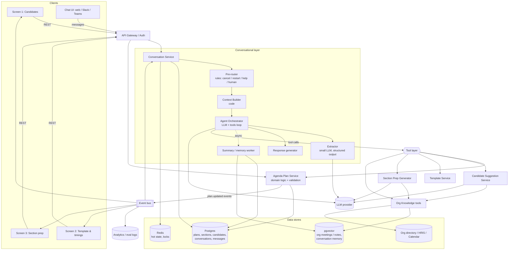
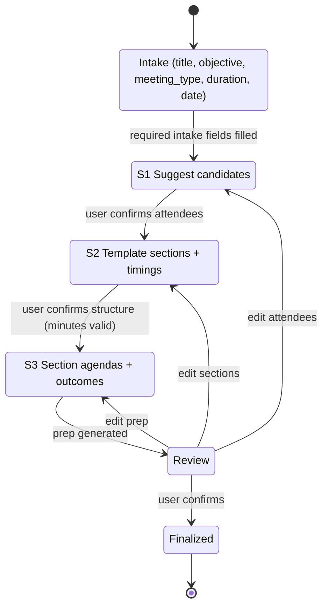
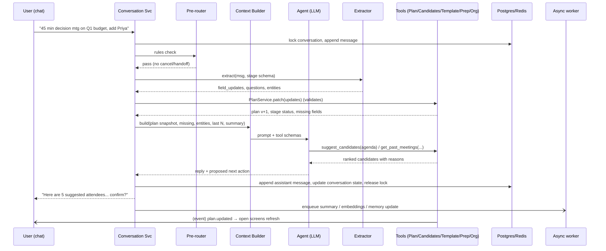
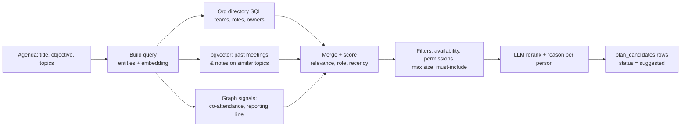
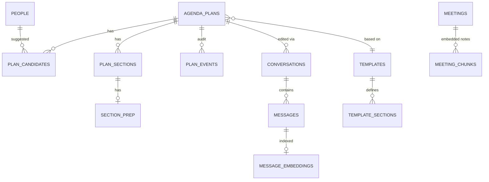
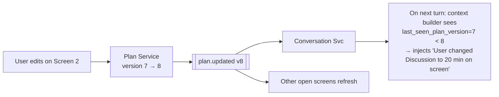

# Agenda Bot: End-to-End Architecture (Conversational + Existing Screens)

## 1. Goal and the key design decision

Today the product has three separate UI screens. We're adding a conversational flow **without losing the ability to serve each screen on its own**.

| Stage | Existing screen | Output artifact |
|---|---|---|
| S1 | Agenda → **suggested candidates (attendees)** | `plan_candidates` |
| S2 | **Meeting template**: sections + timings, user-editable | `plan_sections` |
| S3 | **Per-section agenda and expected outcomes** for the meeting creator to prepare with | `section_prep` |

**Key decision:** both the chat and the screens are *clients* of one **Agenda Plan domain service**. The conversation never owns the data. It reads and writes the same `agenda_plan` record that the screens use, through the same APIs, which become the agent's **tools**.

As a result:
- A user can start in chat and finish on the screens, or the other way round. Both see the same plan.
- Each stage's output is stored on its own, so each screen keeps working unchanged.
- Validation and business rules live in **one place**: the domain service, not the prompt.

---

## 2. High-level architecture



### Components

| Component | Type | Responsibility |
|---|---|---|
| **Agenda Plan Service** | Deterministic code | Source of truth for a plan and its stages. Validation (e.g. section minutes ≤ duration), stage status, versioning. Exposes the REST APIs that screens use **and** the agent uses as tools. |
| **Conversation Service** | Code | Stores conversations and messages, per-conversation lock, runs the turn loop. |
| **Pre-router** | Rules | Cheap exits: "cancel", "start over", "help", "talk to a person", plus PII and safety checks. No LLM call. |
| **Context Builder** | Code | Assembles the prompt: system prompt, plan snapshot, stage + missing fields, entities, pending questions, last N turns, summary. |
| **Agent Orchestrator** | LLM loop | Decides what to do next: call tools, ask the user, or confirm. A single agent with tools is enough here. |
| **Extractor** | Small LLM, structured output | Turns a message into `field_updates[]`, `questions[]`, `entities[]`, `notes[]`, `intent_shift`. |
| **Candidate Suggestion Service** | Retrieval + ranking (+ LLM rerank) | S1: agenda → ranked attendees with a reason for each. |
| **Template Service** | Code + LLM | S2: picks a template by meeting type and proposes sections and timings. |
| **Section Prep Generator** | LLM (+ org knowledge) | S3: writes the agenda points and expected outcomes for each section, plus prep notes. |
| **Org Knowledge tools** | SQL + pgvector | `find_person`, `get_past_meetings`, `search_meeting_notes`, `get_open_action_items`, `get_availability`. Permission-filtered. |
| **Summary / memory worker** | Async LLM | Running summary, long-term user preferences, conversation embeddings. |
| **Event bus** | Infra | `plan.updated` keeps open screens and the chat in sync. |

---

## 3. Conversation flow (stage state machine)

The chat moves through the same three stages as the screens. Each stage has a **gate**: either the user confirms it, or it's auto-filled with defaults the user can edit later.



- The user can **jump between stages** ("actually add Raj", "make the discussion 20 min") at any point. The extractor sends the update to the right stage, and the Plan Service reruns validation.
- If an upstream stage changes, downstream stages are **marked stale**, not silently regenerated. For example, changing the duration marks S2 timings and S3 prep as `stale`. The bot then offers: "Timings no longer add up. Rebalance?"

---

## 4. Turn sequence (one user message)



**Main practices:**
- **Extract, then validate in code, then respond.** The LLM proposes changes; the Plan Service decides whether they're valid.
- The agent writes to the plan **only through tools**, never as free text.
- **Lock per conversation** plus `plan.version` with optimistic concurrency, so chat and screen edits don't overwrite each other.

---

## 5. How each stage works

### S1: Candidate suggestion

- Every candidate is stored with a **reason** and **source signals**. Screen 1 shows them; the chat explains them.
- User actions (accept, reject, add manually) are stored per row, which gives you feedback data for improving ranking.

### S2: Template, sections and timings
- Inputs: `meeting_type`, `duration_min`, objective, and number of attendees.
- The Template Service picks a base template (from your template library), then the LLM adapts its sections. **Code enforces** `sum(section.minutes) == duration_min` (or ≤ it, with a buffer).
- Sections are stored as **individual rows**, so Screen 2 edits (reorder, rename, change minutes) and chat edits ("make discussion 20 min") hit the same rows.

### S3: Per-section agenda and outcomes
- For each section: `agenda_points[]`, `expected_outcomes[]`, `owner`, `prep_notes`, `pre_reads[]`, all generated with org context (past decisions, open action items).
- Generated **per section**, so editing one section only regenerates that section.
- Each item carries `source: generated | user_edited`. **User-edited content is never overwritten** by regeneration unless the user asks.

---

## 6. Data model

Two groups of data: **domain data** (shared with the screens) and **conversation data** (chat only).



### 6.1 Domain tables (serve the screens and the chat)

```sql
CREATE TABLE agenda_plans (
  plan_id        UUID PRIMARY KEY,
  owner_user_id  TEXT NOT NULL,
  title          TEXT,
  objective      TEXT,
  meeting_type   TEXT,              -- kickoff | status | decision | brainstorm | 1on1 | review
  duration_min   INT,
  scheduled_at   TIMESTAMPTZ,
  template_id    UUID,
  stage          TEXT,              -- intake | candidates | template | prep | review | finalized
  stage_status   JSONB,             -- {"intake":"done","candidates":"confirmed","template":"stale","prep":"pending"}
  created_via    TEXT,              -- ui | chat
  version        INT NOT NULL DEFAULT 0,   -- optimistic locking (chat + UI)
  created_at TIMESTAMPTZ, updated_at TIMESTAMPTZ
);

-- Screen 1
CREATE TABLE plan_candidates (
  plan_id      UUID REFERENCES agenda_plans,
  person_id    TEXT,
  role_in_mtg  TEXT,               -- decision_maker | contributor | informed
  score        REAL,
  reason       TEXT,               -- "Owns Q1 budget; attended last 3 budget reviews"
  signals      JSONB,              -- {"topic_sim":0.82,"co_attend":5,"team":"finance"}
  status       TEXT,               -- suggested | accepted | rejected | added_by_user
  source       TEXT,               -- generated | user
  updated_at   TIMESTAMPTZ,
  PRIMARY KEY (plan_id, person_id)
);

-- Screen 2
CREATE TABLE plan_sections (
  section_id   UUID PRIMARY KEY,
  plan_id      UUID REFERENCES agenda_plans,
  position     INT,
  name         TEXT,               -- Recap | Discussion | Decisions | Action items ...
  minutes      INT,
  owner_person_id TEXT,
  source       TEXT,               -- template | generated | user_edited
  status       TEXT,               -- active | stale
  updated_at   TIMESTAMPTZ
);

-- Screen 3
CREATE TABLE section_prep (
  section_id        UUID PRIMARY KEY REFERENCES plan_sections,
  agenda_points     JSONB,         -- ["Review Q1 spend vs plan", ...]
  expected_outcomes JSONB,         -- ["Approve revised budget", ...]
  prep_notes        TEXT,
  pre_reads         JSONB,         -- [{title, url}]
  source            TEXT,          -- generated | user_edited
  status            TEXT,          -- fresh | stale
  generated_with    JSONB,         -- model, prompt version, sources used
  updated_at        TIMESTAMPTZ
);

CREATE TABLE plan_events (          -- audit: who changed what, from where
  plan_id UUID, version INT, actor TEXT,        -- user_id | agent
  channel TEXT,                                  -- ui | chat
  entity TEXT, entity_id TEXT, change JSONB,
  conversation_id UUID, message_seq INT,         -- link back to the chat turn, if any
  created_at TIMESTAMPTZ
);

-- Template library
CREATE TABLE templates (template_id UUID PRIMARY KEY, meeting_type TEXT, name TEXT, version INT);
CREATE TABLE template_sections (template_id UUID, position INT, name TEXT,
                                default_pct REAL, required BOOL, guidance TEXT);
```

### 6.2 Conversation tables (chat only)

```sql
CREATE TABLE conversations (
  conversation_id  UUID PRIMARY KEY,
  user_id          TEXT NOT NULL,
  plan_id          UUID REFERENCES agenda_plans,   -- the plan this chat is editing
  status           TEXT,
  state            JSONB,          -- conversational state only (see 6.3), NOT plan data
  state_version    INT DEFAULT 0,
  summary          TEXT, summary_upto_seq INT,
  created_at TIMESTAMPTZ, updated_at TIMESTAMPTZ
);

CREATE TABLE messages (             -- append-only
  conversation_id UUID REFERENCES conversations, seq INT,
  role TEXT, content TEXT, content_redacted TEXT,
  tool_name TEXT, tool_args JSONB, tool_result JSONB,
  extracted JSONB,
  model TEXT, prompt_tokens INT, completion_tokens INT, latency_ms INT,
  created_at TIMESTAMPTZ,
  PRIMARY KEY (conversation_id, seq)
);

CREATE TABLE message_embeddings (   -- optional; mainly for long-term memory
  conversation_id UUID, seq INT, user_id TEXT, chunk_text TEXT,
  embedding VECTOR(1536), model TEXT, created_at TIMESTAMPTZ,
  PRIMARY KEY (conversation_id, seq)
);
```

### 6.3 What goes in `conversations.state` vs the plan tables

**Rule:** if a screen needs it, it lives in the **plan tables**. `conversations.state` holds only what the *conversation* needs.

```jsonc
{
  "current_stage": "template",
  "field_status": {                         // inferred vs confirmed, for intake fields
    "objective": {"status": "inferred", "evidence": [{"seq": 2, "quote": "need finance on board"}]}
  },
  "entities": [{"type": "person", "name": "Priya", "resolved_person_id": "p_42"}],
  "pending_questions": [{"seq": 9, "text": "suggest an icebreaker", "answered": false}],
  "pending_confirmation": {"stage": "candidates", "proposal_ref": "plan_v7"},
  "notes": ["worried about pushback from finance"],
  "last_seen_plan_version": 7               // detect edits made on screens meanwhile
}
```

### 6.4 Org knowledge (read-only, used through tools)

```sql
-- people(person_id, name, title, team, manager_id, email, skills[], ...)  -- from HRIS/directory
-- meetings(meeting_id, title, date, organizer, attendees[], decisions JSONB, action_items JSONB)
-- meeting_chunks(meeting_id, chunk_no, text, embedding VECTOR(1536))
-- user_preferences(user_id, key, value, source, updated_at)  -- e.g. default_duration, likes_icebreakers
CREATE INDEX ON meeting_chunks USING hnsw (embedding vector_cosine_ops);
```

---

## 7. Agent tools (the same APIs the screens call)

| Tool | Backed by | Used in |
|---|---|---|
| `get_plan(plan_id)` | Plan Service | Every turn (context builder) |
| `update_plan_fields(plan_id, updates, expected_version)` | Plan Service | Intake + edits |
| `suggest_candidates(plan_id, constraints)` | Candidate Service | S1 |
| `set_candidate_status(plan_id, person_id, status)` | Plan Service | S1 |
| `propose_template(plan_id)` | Template Service | S2 |
| `update_section(plan_id, section_id, {name, minutes, position})` | Plan Service | S2 |
| `rebalance_timings(plan_id)` | Plan Service (code) | S2 |
| `generate_section_prep(plan_id, section_ids[])` | Prep Generator | S3 |
| `update_section_prep(section_id, patch)` | Plan Service | S3 |
| `find_person(query)` / `get_past_meetings(...)` / `search_meeting_notes(...)` / `get_availability(...)` | Org Knowledge | S1, S3 |
| `finalize_plan(plan_id)` | Plan Service | Review |

These can be exposed to the agent through function calling, or through an **MCP server** so other agents can reuse them.

---

## 8. Keeping chat and screens in sync


- The chat **always reads the latest plan** through `get_plan` when building context, so it never relies on a stale copy.
- A write with an old `expected_version` gets `409 Conflict`. The agent re-reads the plan and retries, or asks the user.

---

## 9. Context per turn (what's sent to the LLM)

| Part | Source | Budget |
|---|---|---|
| System prompt + stage instructions | Static, versioned | Cached |
| Plan snapshot (compact) | `get_plan` (current stage in full, other stages summarised) | ~300–800 tokens |
| Missing / stale / inferred fields | Plan Service + `conversations.state` | Small |
| Entities, pending questions, notes | `conversations.state` | Small |
| Last N turns (N≈6) | `messages` | ~1–2k |
| Running summary | `conversations.summary` | ~300 |
| Tool results | This turn only | Remaining |

---

## 10. Cross-cutting concerns

- **Evals:** a set of simulated-user scenarios (vague user, everything at once, changes mind, edits mid-chat on a screen). Metrics: stage completion, turns to complete, timing validity, candidate acceptance rate, prep edit rate.
- **Observability:** log the exact context, tool calls, versions and latency for each turn (`messages` + `plan_events`).
- **Safety and permissions:** org tools filter by the requester's access, PII is redacted in `content_redacted`, and no calendar invites are sent without explicit confirmation.
- **Cost and latency:** a small model for extraction and summaries, a stronger model for prep generation, and prompt caching for the system prompt and template definitions.
- **Rollout:** ship the Plan Service APIs first (the screens already need them), then chat as another client. Use a feature flag per user, and stay able to go from chat to the screens and back.

---

## 11. Build order

1. Extract the **Agenda Plan Service** from the current screens (stage tables, versioning, events).
2. Wrap the S1/S2/S3 logic as services with clean APIs, and define the agent tools on top of them.
3. Conversation Service: tables, locking, pre-router, context builder.
4. Extractor + agent loop for **Intake → S1** first, then S2, then S3.
5. Sync events, stale-marking, review/finalize.
6. Evals, the summary worker, long-term preferences.

> **Where this comes from:** the patterns follow the sources in `citations.md`: tool-based agents and routing (Anthropic), slot/form flows (Rasa CALM, Dialogflow CX), structured extraction (OpenAI Structured Outputs), state and message storage (Rasa tracker store, LangGraph checkpointers, Discord), pgvector retrieval, and context engineering (Anthropic). The specific services, tables and field names are a reference design for this product.
