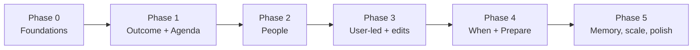

# Agenda Bot: Phased Delivery Plan

**How to read this:**
- **Phases** deliver a usable product at the end of each one, starting small and growing towards the final product.
- **Workstreams** are the layers that can be built **in parallel** by different people within a phase.
- Every phase builds on the same foundations (data model, part statuses, tool interfaces), so nothing built early has to be thrown away.

> **Assumption:** the plan follows the prototype's five parts: **Outcome → Agenda → People → When → Prepare**. The HLD currently describes three parts (Attendees, Structure, Prep); Outcome and When are added here to match the UI. Task IDs look like `D1.3` (workstream D, phase 1, task 3).

---

## 1. Workstreams (parallel layers)

| ID | Workstream | Owns | Talks to |
|---|---|---|---|
| **A** | Platform & infra | AWS accounts, ECS Fargate, RDS Postgres, OpenSearch, Bedrock access, CI/CD, secrets, environments | Everyone |
| **B** | Org knowledge & ingestion | Pipelines from directory/HRIS, calendar and past meetings into OpenSearch; pre-computed relationship signals | E (People, When, Prepare) |
| **C** | Plan domain service | Plan tables, REST APIs, validation, versions, part statuses, staleness, events | D, E, F |
| **D** | Conversation engine | LangGraph graph, extractor, router, context builder, conversation state, messages, streaming | C, E, G |
| **E** | Part generators | One module per part: Outcome, Agenda, People, When, Prepare (each a tool the agent calls) | B, C |
| **F** | UI | Chat shell, streaming, chips, cards, stepper, editing | D, C |
| **G** | Quality, safety & observability | Langfuse tracing, eval sets, simulated users, guardrails, PII redaction, cost dashboards | D, E |

**Contracts to agree in Phase 0** so workstreams don't block each other:
1. **Plan schema and part statuses** (`empty | assumed | draft | confirmed | stale`), owned by C.
2. **Extraction schema** (`field_updates[]` with `part`, `questions[]`, `entities[]`, `requested_part`, `standing_instructions[]`), owned by D.
3. **Part generator interface**, owned by E: `generate(plan, context) -> PartResult{data, status, reasons, assumptions}`.
4. **Chat event protocol (SSE)**, owned by D and F: `token`, `chips`, `card`, `quick_replies`, `part_status`, `done`, `error`.
5. **Mock data and fixtures**: fake org directory, calendar and past meetings, so E and F can start before B finishes.

---

## 2. Phase 0: Foundations (walking skeleton)

**Goal:** one message goes from the UI → FastAPI → LangGraph → Bedrock → back as a streamed reply, stored in Postgres and traced in Langfuse. No agenda logic yet.

| WS | Tasks |
|---|---|
| A | A0.1 AWS envs (dev, staging) · A0.2 ECS Fargate service + ALB (idle timeout 300 s) · A0.3 RDS Postgres · A0.4 OpenSearch domain · A0.5 Bedrock model access + IAM role for the task · A0.6 CI/CD (build, test, deploy) · A0.7 secrets + config |
| B | B0.1 Mock org dataset (people, teams, managers, 50 past meetings) · B0.2 OpenSearch index mappings for `people`, `meetings`, `meeting_chunks` |
| C | C0.1 Plan tables (`agenda_plans`, `plan_sections`, `plan_candidates`, `section_prep`, `plan_events`) with migrations · C0.2 `stage_status` per part · C0.3 `GET/PATCH /plans/{id}` with `version` check |
| D | D0.1 FastAPI SSE endpoint with heartbeat · D0.2 `conversations` + `messages` tables, per-conversation lock · D0.3 LangGraph skeleton (receive → LLM → save) with Postgres checkpointer · D0.4 `llm` wrapper (`extract()`, `generate()`) over the Bedrock client · D0.5 extraction schema v0 in Pydantic |
| E | E0.1 Part generator interface + stub implementations |
| F | F0.1 Chat modal shell (welcome screen, input box, send) · F0.2 SSE client with streaming text · F0.3 Error/retry states |
| G | G0.1 Langfuse self-hosted + tracing on every turn · G0.2 Eval harness skeleton (promptfoo) with 5 sample conversations |

**Exit criteria:** a streamed reply in the UI in under ~2 s to first token; message and trace visible in Postgres and Langfuse.
**Extensible because:** the plan schema, part statuses, event protocol and `llm` wrapper are final shapes that later phases only add to.

---

## 3. Phase 1: Outcome + Agenda (first useful product)

**Goal:** user describes the meeting → bot picks up the facts, confirms the outcome type, and proposes an agenda with section timings that the user can accept or resize.

| WS | Tasks |
|---|---|
| B | B1.1 Load the template library (tracks, section types, default %, prompts per section) into Postgres |
| C | C1.1 Basics fields (title, objective, outcome type, duration, date hint) · C1.2 Section rows with `source = template / generated / user_edited` · C1.3 Validation: minutes add up to the duration · C1.4 `rebalance(duration)` in code |
| D | D1.1 Extractor v1: basics + outcome type + duration, plus **volunteered later-part info** (date hint, names) saved now · D1.2 "Picked up" facts emitted as `chips` events · D1.3 Simple router: Outcome first, then Agenda (still guided, but the router reads part statuses, so Phase 3 can switch to user-led) · D1.4 Quick replies handled by code, not the LLM · D1.5 Context builder v1 (plan snapshot + last 6 turns) |
| E | E1.1 **Outcome** generator: classify the outcome type (decision, alignment, plan, explore) with options for the user to pick · E1.2 **Agenda** generator: pick the track, adapt sections, allocate minutes (Python) |
| F | F1.1 Starter cards ("Make a decision", …) · F1.2 Picked-up chips · F1.3 Outcome option buttons · F1.4 Agenda card (sections, minutes, colours) · F1.5 "Use this / 30 min / 60 min" buttons · F1.6 Stepper showing Outcome and Agenda status |
| G | G1.1 Extraction eval set (50 first messages → expected fields) · G1.2 Timing validity check in CI · G1.3 PII redaction (Presidio) on stored messages |

**Exit criteria:** ≥90% of eval first messages extract the duration and outcome correctly; every agenda adds up to the duration.
**Extensible because:** the router already uses part statuses, and the extractor already captures facts for later parts (e.g. "next Tuesday"), which avoids the prototype's lost-date issue.

---

## 4. Phase 2: People

**Goal:** bot suggests attendees with reasons, warns about missing roles, and the user can add or remove people.

| WS | Tasks |
|---|---|
| B | B2.1 Real directory ingestion (name, title, team, manager) · B2.2 Past meetings ingestion (title, attendees, decisions) · B2.3 Pre-computed signals per person: `top_collaborators`, `topics_owned`, `meeting_roles` · B2.4 Embeddings via Bedrock into OpenSearch · B2.5 Access control fields (`acl`) |
| C | C2.1 `plan_candidates` APIs (suggested / accepted / rejected / added_by_user) · C2.2 Dependency: objective changes mark People as stale |
| D | D2.1 Extractor: person mentions → entity list · D2.2 Name resolution via `find_person` (ask if ambiguous) · D2.3 Router: People part |
| E | E2.1 Retrieval: hybrid search on topic + filter by team · E2.2 Scoring on signals (topic, co-attendance, reporting line, role fit, recency) · E2.3 Role-coverage check (agenda needs vs people) · E2.4 One-line reason per person (LLM) |
| F | F2.1 People cards (role badge, reason, add/remove) · F2.2 "Invite people" search box · F2.3 Role-coverage warning · F2.4 Stepper: People status |
| G | G2.1 People eval set (meeting → expected attendees) · G2.2 Track acceptance rate of suggestions · G2.3 Permission tests: no one sees people or meetings they shouldn't |

**Exit criteria:** ≥60% of suggestions accepted in internal testing; no permission leaks in tests.

---

## 5. Phase 3: User-led conversation + edits

**Goal:** the user can start with any part, change anything at any time, edit past messages, and give standing instructions.

| WS | Tasks |
|---|---|
| C | C3.1 Dependency map + staleness marking (`on_plan_update`) · C3.2 Never overwrite `user_edited` items · C3.3 `plan.updated` events |
| D | D3.1 Router v2: focus from tagged updates, prerequisites, assume-or-ask-once (implementation.md §3.2) · D3.2 Multi-question handling (answer every question in one reply) · D3.3 **Edit a past message**: undo its `state_events`, re-extract, re-apply, mark dependents stale · D3.4 Standing instructions (extract, store, inject into every prompt) · D3.5 Running summary job (Celery) |
| E | E3.1 Each generator handles `assumed` inputs and returns `assumptions[]` for the reply |
| F | F3.1 **Clickable, non-linear stepper** with per-part status (assumed / draft / confirmed / needs update) · F3.2 "Edit message" on hover · F3.3 "Needs update, refresh?" prompts · F3.4 Assumed chips styled differently and editable |
| G | G3.1 Simulated-user evals: jumps between parts, changes of mind, call-backs to earlier details · G3.2 Regression gate in CI |

**Exit criteria:** simulated users who jump straight to People or Prepare complete a plan without being forced into an order; edits never lose user-edited content.

---

## 6. Phase 4: When + Prepare

**Goal:** bot proposes free time slots and drafts prep (per section and per person), with resources attached. Invites are sent only after explicit confirmation.

| WS | Tasks |
|---|---|
| B | B4.1 Calendar connector (free/busy for the organiser and attendees) · B4.2 Meeting notes chunking + embeddings for prep retrieval |
| C | C4.1 `when` fields (slot, timezone) · C4.2 `section_prep` + per-person tasks · C4.3 Resources table (files, links, who gets them) |
| D | D4.1 Router: When and Prepare parts · D4.2 Date-hint use (from Phase 1) when proposing slots · D4.3 Confirmation step before any external action (invite) |
| E | E4.1 **When** generator: free slots honouring the date hint and duration · E4.2 **Prepare** generator: agenda points and outcomes per section, tasks per person, RAG over past decisions and open actions · E4.3 File attach: parse uploads (Unstructured) into prep context |
| F | F4.1 Slot cards + "I'll pick later" · F4.2 Prep card (people tasks, resources, add) · F4.3 Attach file · F4.4 Final review screen + "Send invites" confirm |
| G | G4.1 Prep quality eval (LLM judge + human rubric) · G4.2 Grounding check: prep cites real past notes · G4.3 Guardrail: no invites without confirmation |

**Exit criteria:** end-to-end plan, from first message to invite sent, in under ~8 turns for typical meetings; prep rated "useful" by ≥70% of pilot users.

---

## 7. Phase 5: Memory, scale and polish

**Goal:** the bot gets better per user over time and is ready for wide rollout.

| WS | Tasks |
|---|---|
| A | A5.1 Autoscaling + load test (concurrent streams) · A5.2 Bedrock quota increases · A5.3 Cost alerts + budgets · A5.4 Production runbooks |
| B | B5.1 Publish finalised agendas back to org knowledge (through the pipeline) |
| C | C5.1 Sync with the existing screens (shared plan service, version conflicts) |
| D | D5.1 Long-term memory: preferences (semantic) and past agendas (episodic) · D5.2 "Same as last time" re-use · D5.3 Prompt caching tuned · D5.4 Optional: Haiku for extraction if latency or cost needs it |
| E | E5.1 Ranking weights tuned from acceptance data · E5.2 Template suggestions learned from past meetings |
| F | F5.1 Accessibility + mobile · F5.2 Open the same plan in chat or screens · F5.3 Memory controls (view and delete what the bot remembers) |
| G | G5.1 Online quality monitoring (sampled LLM judge) · G5.2 NeMo Guardrails topic rails · G5.3 Data retention + deletion jobs |

**Exit criteria:** p95 time to first token under 2 s at target load; cost per finished plan within budget; memory controls live.

---

## 8. UI delivery by phase (summary)

| Phase | What the user sees |
|---|---|
| 0 | Chat modal with streaming replies |
| 1 | Starter cards, picked-up chips, outcome options, agenda card with timings, resize buttons, stepper (2 steps) |
| 2 | People cards with reasons, invite search, role-coverage warning |
| 3 | Clickable stepper with statuses, edit-message, "needs update" prompts, editable assumed chips |
| 4 | Time-slot cards, prep card, attachments, review + send invites |
| 5 | Memory controls, chat ↔ screens hand-off, mobile and accessibility polish |

## 9. How each part grows across phases

| Part | Phase introduced | Grows in |
|---|---|---|
| Outcome | 1 | 3 (user-led), 5 (learned defaults) |
| Agenda | 1 | 3 (staleness, edits), 5 (learned templates) |
| People | 2 | 3 (edits), 5 (tuned ranking) |
| When | 4 | 5 (preferences, e.g. "no Friday meetings") |
| Prepare | 4 | 5 (memory of past agendas) |

## 10. Risks to watch

| Risk | Mitigation |
|---|---|
| Org data quality (missing managers, roles) | Start B early; mock data first; data-quality report in B2 |
| Permission leaks via search | `acl` filters in every query; tests in G2.3 |
| Bedrock cost and quotas | Langfuse token tracking from Phase 0; quota request in A0.5 |
| Changing the conversation flow late | Part statuses and the router reading them are in place from Phase 1 |
| Calendar integration complexity | Isolate behind the When generator; "I'll pick later" fallback |
